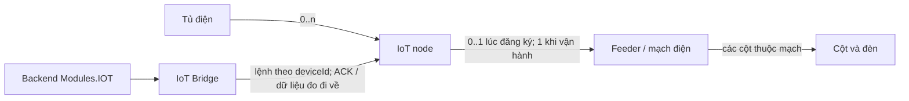

# IOT-CONSOLIDATION — khảo sát phase 2

Khảo sát 15/11/2026, **sau phase 1 đã kiểm chứng/commit `f46364d`**, trên nhánh `feat/CABINET-multiple-iot-nodes-dev`.
Phạm vi: bỏ quản lý relay khỏi nghiệp vụ; một cabinet nhiều node, mỗi node điều khiển một feeder;
hợp nhất trách nhiệm backend của Telemetry vào IOT và dùng Bridge làm kênh thiết bị.
**Chưa hiện thực phase 2; mọi phương án dưới đây chờ Mỹ chốt.**

## Kết luận

Làm được, nhưng **không thể chỉ xóa project Telemetry**. Project này hiện giữ node, quan hệ điều khiển, xác thực thiết bị,
firmware, job offline và toàn bộ lịch sử lệnh cũ. Bridge hiện điều khiển theo `deviceId`, không mang `relay_no`, nên phù hợp
hướng một node–một feeder. Hợp nhất module không đòi xóa các bảng lịch sử hay dữ liệu đo.

**Không có bảng `relay` riêng để DROP.** Relay hiện là `relay_no` trong `feeder_control` và snapshot của `lighting_command`.
Đề xuất trước mắt giữ `feeder_control` làm liên kết vận hành node↔feeder, bỏ relay khỏi giao diện nghiệp vụ theo lộ trình;
không cần dựng bảng thay thế chỉ để đổi tên. Không đưa mode/lần báo vào bảng inventory `feeder` vì PUT tài sản là thay thế toàn phần.

Mô hình đích đề xuất, trong đó bước đăng ký có thể chưa gán feeder:



Feeder mô tả mạch nào cấp điện cho cột nào; node là thiết bị thực hiện lệnh. Telemetry là dữ liệu thiết bị báo về (điện, lux,
thời điểm, kết quả điều khiển). Bỏ quản lý relay hoặc tên module Telemetry không loại bỏ nhu cầu giữ các dữ liệu đó.
Phần đóng cắt vật lý của mạch vẫn do phần cứng thực hiện; khảo sát này không thay sơ đồ điện.

## Code hiện tại và nơi bị ảnh hưởng

| Vùng | Bằng chứng trong code | Ảnh hưởng khi bỏ Telemetry/relay |
|---|---|---|
| Composition | `src/LuxMap.Api/Program.cs`, `src/LuxMap.Modules.Telemetry/TelemetryModule.cs`, `LuxMap.slnx` | Di chuyển đăng ký service, job, port, version column và module assembly; gỡ project sau cùng |
| Model/FK | `Telemetry/Entities/{IotNode,FeederControl}.cs`, `Configurations/IotConfigurations.cs`, `Configurations/FaultOriginNodeConfiguration.cs` | Giữ node, firmware, FK xã/tủ, liên kết sự cố và ràng buộc Restrict; bổ sung cardinality một node–một feeder sau đối chiếu dữ liệu |
| Entity discovery | `src/LuxMap.Persistence/LuxMapDbContext.cs:145–149` | EF quét configuration theo assembly đăng ký. Xóa module trước khi chuyển cấu hình có thể làm entity biến mất khỏi model |
| Registry/API | `Telemetry/Registry/*`, `IOT/IotRegistrationStore.cs` | Registry node ở Telemetry; source Bridge nằm riêng, `feeder_id` trong JSON profile. Hiện hai nguồn mapping, phase 1 chỉ canh mâu thuẫn |
| Lệnh cũ | `Telemetry/Lighting/*`, `Telemetry/Mqtt/*` | Giữ idempotency `client_op_id`, `seq`, TTL, audit, lịch sử, ACK muộn, thay lệnh khi đổi dây/cờ điều khiển; không thay bằng chỉ HTTP 200 từ Bridge |
| Bridge | `IOT/IotDiagnosticsService.cs`, `src/LuxMap.IotBridge/{DeviceStore,MqttBroker}.cs` | API Bridge lưu desired command, có command ID/version/expiry/ACK và lịch AUTO; main DB hiện chỉ ghi requested/accepted vào audit đăng ký, không dùng `lighting_command` cho lệnh Bridge |
| Đọc tài sản/bản đồ | `Assets/IFeederControlLookup.cs`, `IFeederPowerLookup.cs`, `ICabinetDeviceLookup.cs`, `Map/Features/MapQueryService.cs` | Giữ các port Assets; đổi implementation sang IOT. Map đang đọc entity Telemetry trực tiếp; phải chuyển project ref/namespace và các join |
| Auth | `Api/Authorization/{DeviceAuthenticationHandler,BrokerAuthenticationHandler}.cs`, `Telemetry/Mqtt/BrokerAuthController.cs` | Kênh cũ dùng secret node trong Postgres và callback EMQX. Bridge dùng secret gateway riêng + route; không thể dùng/xóa hai loại secret như nhau |
| Offline/firmware | `Telemetry/Jobs/NodeOfflineJob.cs`, `NodeSilence.cs`, `LightingCommandService.TouchAsync` | Chuyển trách nhiệm giữ `last_report_at`, firmware và job; Bridge hiện chưa ghi các trường này về Postgres. Xem IOT-CONS-1, VR-10…12 trong drift |
| Dữ liệu/ops | `IotBridge/TelemetryArchive.cs`, `DeviceStore.cs`, `deploy/compose.yml`, `deploy/backup.sh`, `scripts/copy_dev_to_supabase.py` | SQLite/JSON trong volume Bridge nằm ngoài pg_dump/PLAN. Backup hiện chưa sao lưu bridge_data; phải diễn tập khôi phục trước cutover |
| Test/docs/FE | Registry/Lighting/Mqtt/BrokerAuth/ArtifactVersion/ScheduledJob/FeederState/Cabinet tests; OpenAPI generator, FE guide, drift, ERD, deploy docs | Thay coverage theo hành vi; giữ case scope/race/history/MQTT. Không có mã FE/mobile hoặc firmware `.ino` trong repo này để xác nhận consumer đã ngừng dùng relay |

Đường phụ thuộc hiện tại: **IOT → Telemetry → Assets/Faults/Persistence**; Map và Api cũng tham chiếu Telemetry.
Đích đề xuất: **IOT → Assets/Faults/Persistence**, Map/Api → IOT; Assets tiếp tục hỏi qua port, không thêm Assets → IOT.
Chuyển namespace/assembly phải giữ mapping DB và tên FK/index rõ ràng; PR chỉ chuyển module cần chứng minh **không có DDL ngoài ý muốn**.

## Bảng và dữ liệu: giữ gì, bỏ gì

| Kho hiện có | Vai trò | Đề xuất |
|---|---|---|
| Postgres `electrical_cabinet`, `feeder`, `pole` | Topology tài sản | Giữ |
| `iot_node` | Identity, xã/tủ, cờ điều khiển, credential cũ, last report, firmware hiện tại | Giữ bảng/ID; di chuyển entity/config sang IOT |
| `iot_node_firmware` + `artifact_version` | Lịch sử firmware bất biến và registry | Giữ; không suy firmware cũ từ firmware hiện tại |
| `feeder_control` | Mapping hiện tại + mode báo về + mode_seq + xã/tủ | Giữ làm binding vận hành; đề xuất UNIQUE node_id sau khi dọn xung đột bằng quyết định có audit. Bỏ relay khỏi API active trước; cột hiện hữu chỉ bỏ sau cutover |
| `lighting_request`, `lighting_command` | Ý định/lịch sử thực thi và audit snapshot | Giữ, kể cả `relay_no` của lệnh cũ. Không dựng lại lịch sử từ binding hiện tại |
| `fault.origin_node_id`, `audit_event`, `scheduled_job` | Sự cố, dấu vết và lease job | Giữ FK/ID và job name; không xóa vì đổi module |
| `iot_server_registration`, `iot_source_registration`, `iot_registration_audit` | Nguồn Bridge và audit | Giữ; đưa binding feeder về một nơi chuẩn, profile còn transport/threshold. Audit append-only không xóa |
| Bridge `telemetry.sqlite` (bảng `telemetry`) | Toàn bộ mẫu, cursor, dedup | Giữ; chưa cần thêm Postgres `telemetry_reading` chỉ để hợp nhất module |
| Bridge JSON | desired command/ACK, dedup ledger, routes, hash secret gateway | Giữ và backup/restore nhất quán cùng SQLite; không ghi đè khi recreate service |

Hiện không có model Postgres `telemetry_reading`; nhận định “bỏ Telemetry = xóa bảng telemetry” không khớp code này.
Hợp nhất module trước có thể không đổi schema. **Chưa đề xuất DROP bảng nào trong bước đầu phase 2.**

## Những khác biệt phải giải trước cutover

1. **Một node hiện có thể nối nhiều relay/feeder.** Bridge source đã là một profile/feeder cho mỗi node; raw unique index của PR #256
   chặn hai source DB cùng feeder, nhưng không thay luật một node có nhiều `feeder_control`. Không tự chọn feeder đầu hay gộp node.
2. **Hai vòng đời lệnh khác nhau.** Kênh cũ có trạng thái pending/delivered/applied/failed/expired/superseded và idempotency;
   Bridge lưu desired command, version và ACK của desired command hiện tại. TTL mặc định cũ 60 giây, Bridge 5 phút.
   Main Bridge POST nhận `{mode: MANUAL, command: ON|OFF}` hoặc `{mode: AUTO}`; cũ dùng `on|off|auto`.
   Lịch AUTO cũng nằm ở Bridge. Cần adapter có đặc tả và test; accepted không phải applied, mất HTTP response không chứng minh lệnh chưa được nhận.
3. **Hai giao thức MQTT khác nhau.** Cũ `luxmap/v1/nodes/{node_id}/relays/{relay_no}/command`, seq/receipt/ack/reply;
   Bridge `luxmap/{deviceId}/command`, commandAck/telemetryAck, commandId/version/expiry, command retained.
   ID `NODE-…` của backend khác deviceId và gatewayId. Không đổi topic/credential mặc nhiên khi chuyển project.
4. **Liveness khác freshness số đo.** Map/job cũ dùng Postgres `last_report_at` + `iot_offline_after_minutes` (mặc định 60 phút).
   Bridge có heartbeat gateway online trong 30 giây, diagnostics/số đo dùng `NodeProfile.MaxSilenceSeconds` (mặc định 60 giây).
   Gateway sống không chứng minh từng node có mẫu mới; ba tín hiệu này không phải một ngưỡng để thay lẫn nhau.
5. **Traceability/retention.** Bridge mẫu hiện chưa có firmware (VR-10); estimator tính lúc đọc chưa lưu (VR-12).
   SQLite dedup theo device + session + sequence, cursor riêng; RTC là giờ không offset được backend diễn giải UTC+07.
   Nếu thêm ingest Postgres phải chốt identity/dedup, server/device mapping theo thời gian, UTC và nguồn dữ liệu,
   tránh gắn mẫu cũ sang feeder mới khi rebind. Mẫu cũ thiếu phiên bản giữ “không rõ”. Không xóa mẫu chỉ vì hết bảo hành.
6. **Cutover chưa được đo trên môi trường thật.** Repo không chứng minh hiện có bao nhiêu node nhiều feeder, nguồn tĩnh trùng DB,
   lệnh mở hay client firmware/FE dùng kênh cũ. Cần audit read-only có scope và snapshot backup khi triển khai được duyệt.

## Lộ trình đề xuất, chưa thực hiện

**PR A — hợp nhất module, giữ hành vi.** Chuyển entity/config/registry/job/port/auth references và lịch sử sang Modules.IOT,
chuyển service registration + VersionedResultColumn và test-host catalogs; bỏ project Telemetry khi không còn ref.
Giữ API, schema, secret và hai transport hiện tại. Kiểm model migration diff rỗng, raw FK/index còn, full regression + real MQTT.
Rollback là quay code cũ vì chưa đổi dữ liệu/schema/giao thức.

**PR B — binding một node–một feeder và điều khiển qua Bridge.** Audit dữ liệu trước; trường hợp nhiều feeder hoặc source mâu thuẫn
phải quyết định sửa mapping có audit. Chọn một mapping chuẩn, backfill có đối chiếu, giữ FK cùng xã/tủ và UNIQUE một feeder/một node.
Adapter đưa hai API điều khiển vào một vòng đời/lịch sử backend, giữ snapshot lệnh cũ và tương thích client;
chốt quy tắc TTL/AUTO/ACK/retry/rebind/khóa trước khi code. Hoàn thiện heartbeat node/firmware/version từng mẫu, giữ job offline và backup Bridge
trước khi tắt kênh cũ. Rollback chỉ khi mapping và firmware còn tương thích với adapter cũ; không phát lại lệnh đã áp dụng.

**PR C — gỡ legacy sau xác nhận consumer.** Sau WP5/WP6/Đạt xác nhận và diễn tập đủ: tắt writer cũ, kết thúc/hết hạn lệnh mở,
gỡ relay UI/routes và Device/EMQX cũ khi không còn caller. Giữ đọc lịch sử cũ; không DROP lịch sử/mẫu đo.
Bỏ cột relay của mapping hiện tại hoặc đổi tên bảng là bước schema riêng nếu thực sự cần, với migration/rollback và backup đã duyệt.
Không tự gộp PR C vào PR A chỉ để xóa tên Telemetry nhanh hơn.

## D-item cần Mỹ chốt trước hiện thực

| Mã | Cần chốt | Đề xuất và lựa chọn khác |
|---|---|---|
| D-1 | Node chưa cấu hình có được chưa gán feeder? | Cho 0..1 lúc onboarding, bắt buộc 1 khi điều khiển; feeder có 0..1 controller cùng tủ/xã. Bắt buộc feeder ngay lúc tạo đơn giản invariant nhưng đổi quy trình đăng ký hiện tại |
| D-2 | Nơi chuẩn lưu node↔feeder | Giữ `feeder_control` làm binding/control state và siết UNIQUE node_id; profile Bridge không là mapping thứ hai. Đưa lên iot_node/source JSON ít dòng hơn nhưng cần thiết kế lại FK/scope/control-state và nhiều đường đọc |
| D-3 | Có chọn Bridge làm đường thiết bị duy nhất? | Đề xuất có, nhưng chỉ gỡ HTTP Device/EMQX relay sau kiểm kê và xác nhận firmware/consumer. Đây là phần còn mở của VR-11, chưa coi là đã duyệt |
| D-4 | Lịch sử/vòng đời lệnh chuẩn | Giữ backend request/command/audit hiện có, adapter Bridge; chốt TTL, AUTO, idempotency, mapping ACK và cách đồng bộ ACK về backend. Chỉ giữ Bridge desired command sẽ mất các bảo đảm/lịch sử hiện có |
| D-5 | Tương thích relay API/field cũ | Deprecate có mốc với WP5/WP6/Đạt, thêm bề mặt node/feeder theo spec đã duyệt; không xóa field đã publish ngay. Adapter legacy relay=1 chỉ là lựa chọn tạm, không tự quy đổi relay 2..32 |
| D-6 | Liveness node và firmware từ Bridge | Bổ sung báo cáo có identity/version theo node, cập nhật last_report_at/histories có scope và giữ NodeSilence/job; tách gateway availability với độ mới số đo. Chốt payload với Đạt; không dùng heartbeat gateway “1” thay node heartbeat |
| D-7 | Nơi giữ telemetry và retention | Giữ SQLite Bridge hiện tại trước, bổ sung provenance/backup/restore. Chuyển sang Postgres chỉ nếu có nhu cầu ingest/thống kê rõ, làm migration dữ liệu riêng, không phải điều kiện để xóa project Telemetry |
| D-8 | Đóng/gỡ legacy | Chia A→B→C; chỉ C khi audit data/consumer, thực thi/ACK/AUTO/offline/restore/rollback đều đạt. Không gỡ history tables; destructive cleanup cần phê duyệt riêng |

## Bằng chứng khảo sát và tiêu chí kiểm phase 2

```text
$ git rev-parse --short HEAD
f46364d
$ python3 (đếm *.cs nguồn, loại bin/obj; đọc ProjectReference; đếm ops trong OpenAPI)
LuxMap.Modules.Telemetry: 27 C# source files
LuxMap.Modules.IOT: 6 C# source files
LuxMap.IotBridge: 8 C# source files
Telemetry project consumer: src/LuxMap.Modules.Map/LuxMap.Modules.Map.csproj
Telemetry project consumer: src/LuxMap.Modules.IOT/LuxMap.Modules.IOT.csproj
Telemetry project consumer: src/LuxMap.Api/LuxMap.Api.csproj
/api/v1/assets/iot-nodes 7 operations
/api/v1/lighting 3 operations
/api/v1/device 2 operations
/api/v1/iot 16 operations
PostgreSQL telemetry_reading model: False
$ rg -n 'node\.(LastReportAt|FirmwareVersionId) =' src/LuxMap.Modules.Telemetry/Lighting/LightingCommandService.cs
306:        if (node.FirmwareVersionId == versionId) return;
307:        node.FirmwareVersionId = versionId;
561:            node.LastReportAt = now;
$ rg -n 'bridge_data|backup' docs/deploy/vps.md
260:**Dữ liệu.** `data/` của bridge (hash secret gateway, `telemetry.sqlite`, lệnh) nằm trong volume `bridge_data`.
261:⚠️ `backup.sh` **chưa** sao lưu volume này.
```

Các con số mô tả phạm vi, không phải ước lượng số dòng sẽ sửa. Khảo sát dựa trên source/spec/deploy scripts, không đăng nhập VPS
hoặc chạy SQL vào dev. Báo cáo không xác nhận trạng thái thiết bị/consumer thực tế.

Khi hiện thực cần kiểm: một node/feeder; node chưa gán; rebind khi có lệnh mở; scope xã/cùng tủ; hai lần bấm đồng thời;
command duplicate/out-of-order/ACK muộn/expiry/offline/timeout; AUTO và timezone; reboot Bridge/node;
replay mẫu cũ không làm node sống giả; firmware thay đổi; map/inventory/history nhất quán; restore Bridge+Postgres;
API migration và khôi phục code cũ không làm thực thi lại lệnh. Phải kiểm Bridge thật/MQTT thật, không chỉ fake HTTP.

✅ Verified: khảo sát đối chiếu source, snapshot/schema config, spec và scripts hiện tại; không hiện thực phase 2.
⚠️ Could not verify: dữ liệu/caller dev/VPS, firmware vật lý, FE/mobile ngoài repo, restore Bridge thực tế.
📌 Remaining assumptions: D-1…D-8 đều là đề xuất; chưa tạo endpoint/config/migration hoặc xóa bất cứ thành phần nào.
