# State Machines — LuxMap backend

Drawn from **the code running on `dev`**, not from the specification: first version 14/10/2026, section 10 added
16/10/2026 after POLE-PHOTO-AI; **re-checked in full against the code on 20/10/2026** (a read-only Codex review, every
finding verified against the code) and sections 11–13 added. Each section names the files that hold its transition rules:
whoever changes a rule updates the diagram in the same PR. State names are **wire values** (lowercase snake_case strings) —
exactly what the API returns; exceptions are stated in each section.

Conventions for every machine below:

- A transition not shown in the diagram → **409** (`INVALID_STATE_TRANSITION` or the specific code named in each section).
  Invalid input sent with it (a missing field, an expired link…) is **400**, not 409.
- Faults, work orders and citizen reports return **`allowed_actions`** so the front end hides a button up front instead of
  letting the user press it and fail. The other machines have no such field.
- Business state changes are written to the **append-only audit** (BE-23a, D-R13): **exactly one** row per save, and one
  operation may span several saves (for example receiving a pole photo: `submitted`, then `analyzed`). Exceptions: user
  accounts (section 8) and refresh tokens (section 13) belong to no commune, so they are only written to the structured log;
  lamps (section 11) only stamp `updated_by` / `updated_at` on their own row.
- A closing state (`[*]` at the end) is final: there is no way back; whatever comes next is a **new** record.

| # | State machine | Stored in | Transition rules live in |
|---|---|---|---|
| 0 | Overview — how the machines connect | — | — |
| 1 | Fault `fault_status` | `fault.fault_status` | `Faults/FaultTransitions.cs`, `FaultReviewRules.cs` |
| 2 | Work order `wo_status` | `work_order.wo_status` | `WorkOrders/WorkOrderRules.cs`, `WorkOrderService.cs` |
| 3 | Survey sweep `survey_sweep.status` | `survey_sweep.status`, `processing_status` | `Survey/Ingest/SurveyIngestService.cs`, `Processing/SurveyProcessor.cs`, `Review/SurveyReviewService.cs` |
| 4 | Citizen report | `citizen_report.status` | `Citizen/CitizenReviewService.cs`, `PublicReportService.cs` |
| 5 | QR code on a pole | `qr_code.revoked_at` | `Citizen/QrCodeService.cs` |
| 6 | ON / OFF / AUTO command | `lighting_command.status` | `Telemetry/Lighting/LightingCommandService.cs`, `Telemetry/Mqtt/MqttLightingHandler.cs` |
| 7 | IoT device status `node_status` | **not stored**, computed on read | `Telemetry/IotOptions.cs` (`StatusAt`), `Jobs/NodeOfflineJob.cs` |
| 8 | User account | `is_locked`, `password_set_at` | `Identity/Accounts/UserAdminService.cs`, `PasswordService.cs` |
| 9 | Lamp condition at a pole `fixture_status` | `pole_current_status` | `Survey/Processing/Frames/FrameClassification.cs` (classification), `Survey/Review/SurveyReviewService.cs` (sweep review), `ReviewedPolePhotoPublisher.cs` (pole photo confirmation); both write through `PoleStatusPublication.cs` |
| 10 | Pole photo in a work order (AI ON/OFF) | `work_order_pole_photo.decision`, `cv_state` | `WorkOrders/WorkOrderPolePhotoService.cs`, `Survey/Review/ReviewedPolePhotoPublisher.cs` |
| 11 | Lamp — fitted / removed | `fixture.removed_date` | `Assets/Crud/AssetCrudService.cs` |
| 12 | Relay mode `control_mode` | `feeder_control.control_mode`, `mode_seq` | `Telemetry/Lighting/LightingCommandService.cs` (`RecordAsync`) |
| 13 | Sign-in session — refresh token | `refresh_token.revoked_at`, `revoked_reason` | `Identity/Auth/AuthService.cs`, `Accounts/AccountTokens.cs` |

---

## 0. Overview

The fault (`fault`) is the centre: five channels create it, and work orders carry it to the end. This is a flow diagram,
not a state machine — it only shows which machine triggers which.

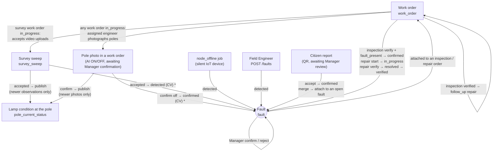

- `*` A sweep or a pole photo creates a fault only when its observation is **applied** (newer than the pole's current
  observation) and the pole has **no** open fault of the same type — details in section 1.
- An inspection order takes any open fault; a repair order only takes `confirmed` / `in_progress` faults.
- A fault belongs to **one** unclosed work order at a time (409 `FAULT_ALREADY_IN_WORK_ORDER`); a `verified` / `cancelled`
  order releases its links (`work_order_fault.released_at`) so the fault can be attached to another order.

---

## 1. Fault — `fault_status`

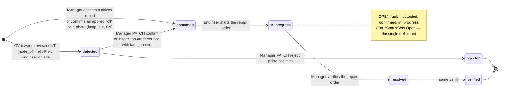

- `PATCH /faults/{id}` can **only** do `detected → confirmed | rejected` (`FaultReviewRules.IsReviewTransition`). The three
  later steps are driven by the **repair order**; sending them through `PATCH` → 409 even though the machine allows them.
- `resolved` and `verified` are written in **the same** work order verify: `resolved_by` is the assigned engineer (time =
  the order's `completed_at`), `verified` is the Manager who signs it off. Today no path stops at `resolved`.
- A fault held by an unclosed repair order cannot be reviewed (`allowed_actions` empty, WO-10).
- `fault_type` never changes; reclassification (`lamp_out` ↔ `lamp_dim`) goes into `override_fault_type`, only while the
  fault is open.
- **De-duplication on automatic creation:** a sweep or a pole photo creates a fault only when the pole has **no** open
  fault of the same effective type (`override_fault_type ?? fault_type`). Sweep review creates `lamp_out` / `lamp_dim` at
  `detected`; confirming an "off" photo creates `lamp_out` straight at `confirmed` because the Manager has seen the photo
  (`origin_pole_photo_id` points at it). Both create only when the observation is **applied** (newer than the pole's
  current observation, section 9). An "on" photo **never** closes a fault.
- ⚠️ A repair order **cancelled** while its fault is `in_progress`: the fault stays `in_progress` (the link is released).
  It is still an open fault and can join a new repair order; that order's `start` skips it, its `verify` still takes it to
  `verified`.

---

## 2. Work order — `wo_status`

Three kinds (`task_kind`): `inspection`, `repair`, `survey` (night survey) — one state machine for all three.

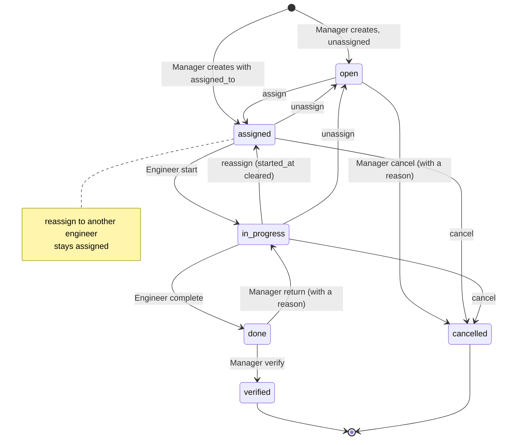

| Action | Who | From | Extra conditions |
|---|---|---|---|
| `assign` / `reassign` / `unassign` / `edit` / `cancel` | Manager | `open`, `assigned`, `in_progress` | the assignee must be an active Field Engineer covering the order's commune (survey order: every commune of its segments), otherwise 409 `ASSIGNEE_NOT_ELIGIBLE`; reassigning to the current assignee changes nothing; `cancel` requires `note` |
| `start` | **Assigned** engineer | `assigned` | repair order: faults `confirmed` → `in_progress` |
| `complete` | Assigned engineer | `in_progress` | `report_note` ≥ 10 characters (after trimming); a repair order needs an `after` photo (409 `AFTER_EVIDENCE_REQUIRED`); an inspection order needs `fault_outcomes` for every fault |
| `return` | Manager | `done` | requires `note` |
| `verify` | Manager | `done` | repair: faults → `resolved` → `verified`; inspection: faults with `fault_present` + `detected` → `confirmed` |
| `follow_up` | Manager | `verified` | only an **inspection** order can spawn a chained **repair** order (FR-2); it needs at least one `fault_present` fault (409 `NOTHING_TO_FOLLOW_UP`), each chosen fault must still be eligible for repair (409 `FAULT_STATUS_NOT_ELIGIBLE`) and not held by another order (409 `FAULT_ALREADY_IN_WORK_ORDER`) |

- `verified` and `cancelled` set `closed_at` and **release** every fault link — those faults can join another order.
- A repair order takes only `confirmed` / `in_progress` faults; an inspection order takes any open fault; a survey order
  takes none.
- A survey order accepts video uploads only while `in_progress` (see section 3).
- The `work_order_overdue` job (BE-26) flags overdue `open | assigned | in_progress` orders — a notification only, it
  **never** changes the status.

---

## 3. Survey sweep — `survey_sweep.status`

A sweep has two columns: `status` (the full, displayed lifecycle) and `processing_status` (the worker's part only). The
diagram follows `status`; the table under it gives the matching `processing_status`.

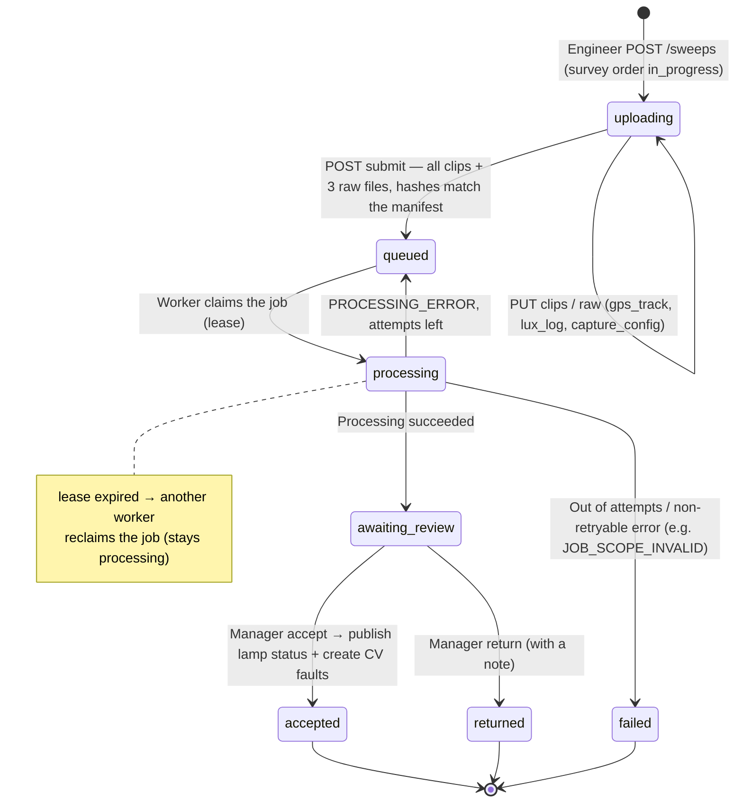

| `status` | `processing_status` |
|---|---|
| `uploading` | `not_started` |
| `queued` | `queued` |
| `processing` | `processing` |
| `awaiting_review`, `accepted`, `returned` | `succeeded` — review does not change the processing result |
| `failed` | `failed` |

- `submit` with files missing → 409 `UPLOAD_INCOMPLETE`; a hash mismatch → 409 `MANIFEST_MISMATCH`. Re-sending an identical
  `submit` after the sweep has left `uploading` is idempotent (returns the earlier result).
- Review checks, in order: `run_id` must be a **`succeeded`** processing run of that sweep (409 `INVALID_REVIEW_RUN`) → a
  repeat with **the same `client_op_id` and content** returns the earlier result, the same key with different content →
  409 `IDEMPOTENCY_CONFLICT` → sweep not in `awaiting_review` → 409 `SWEEP_ALREADY_REVIEWED` → `expected_version`
  mismatch → 409 `VERSION_CONFLICT`.
- `accept` also requires the sweep's poles to **still** have the commune / `data_source` they had at processing time (409
  `SURVEY_SCOPE_CHANGED`).
- **Only `accepted` publishes** results to `pole_current_status` (section 9) and creates `lamp_out` / `lamp_dim` faults
  (under the de-duplication rule in section 1). `returned` only records the decision; surveying again is a new sweep.
- ⚠️ A `data_source = field` sweep currently fails at the `video_clock` stage with `VIDEO_DEVICE_MAPPING_PENDING` (the
  D-07 gate is still in place); a `failed` sweep has no path back into the queue.

---

## 4. Citizen report — `citizen_report.status`

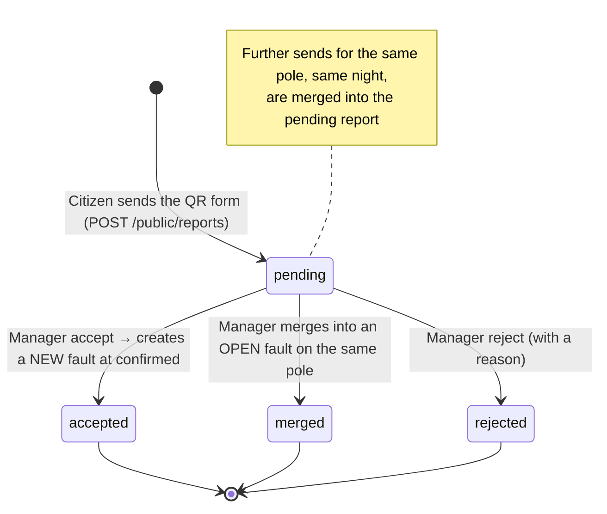

- A citizen report **never** becomes a fault by itself — it always goes through a Manager (D-R1).
- Each decision carries the `submission_count` that was read; a new send in between → 409 `CITIZEN_REPORT_CHANGED`.
  Decided **once**: a second decision → 409 `CITIZEN_REPORT_ALREADY_DECIDED`.
- `accept` creates `lamp_out` / `lamp_dim` only when the report has a send of that type (409
  `CITIZEN_REPORT_NOT_ACCEPTABLE`) and the pole has **no** open fault of that type (409 `OPEN_FAULT_EXISTS` — use `merge`
  instead).
- `merge` only into an open fault (`detected | confirmed | in_progress`) **on that same pole**, otherwise 409
  `FAULT_NOT_MERGEABLE`.

---

## 5. QR code on a pole

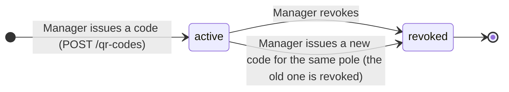

- At most **one** `active` code per pole (`ux_qr_code_pole_id_active`). Revoking twice → 409 `QR_CODE_ALREADY_REVOKED`.
- A `revoked` code can no longer send reports. A send and a revoke take the same `pole` row lock; the send re-checks the
  code **under that lock**, so a code revoked by then refuses the send.

---

## 6. ON / OFF / AUTO lighting command — `lighting_command.status`

**Testbed** devices only (`supports_remote_control = true`), Manager only (D-R7). One press creates one command per wired
relay of a device that has been issued a secret; no controllable relay → 409 `NO_CONTROLLABLE_RELAY`.

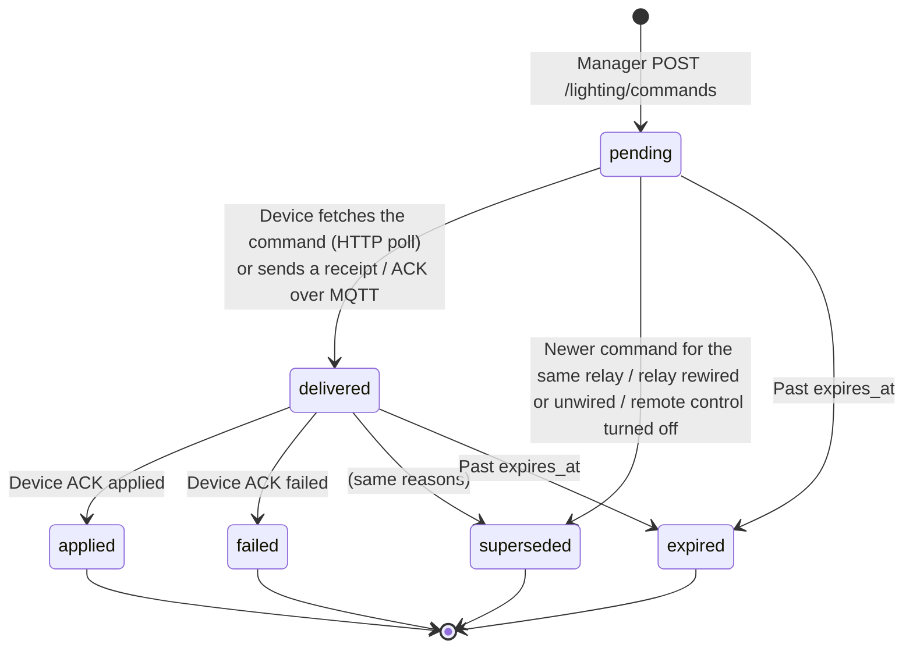

- Over **HTTP**, an ACK on a command still `pending` → 409 `COMMAND_NOT_DELIVERED` (fetch the command first). Over
  **MQTT**, a valid ACK on a `pending` command moves it to `delivered` first, then applies the result.
- An ACK must carry the command's `seq`; `applied` must report the requested mode, `failed` must carry an `error` —
  otherwise 400. Repeating the final ACK unchanged → 200; the same command with different content → 409.
- An ACK on an `expired` / `superseded` command → 409 `COMMAND_CLOSED`, but the report is **still stored** in the history:
  the device is telling the truth about its relay. The relay mode changes under the rule in section 12.
- `expired` is written when a write touches the device; on read, an open command past its deadline **shows** as `expired`
  at once.

---

## 7. IoT device — `node_status`

Not stored in the database: computed from `last_report_at` and `Iot:OfflineAfter` (default 1 minute) on every read.

```flowchart TD
    A["Scheduled job: node_offline (BE-26)"] --> B["Find IoT devices"]
    B --> C{"Has reported before?"}

    C -- No --> D["Keep never_reported"]
    C -- Yes --> E{"Silence duration > OfflineAfter?"}

    E -- No --> F["No offline fault created"]
    E -- Yes --> G{"Already processed this offline transition?"}

    G -- No --> H["Create one node_offline fault"]
    H --> I["status = detected"]
    I --> J["source_channel = iot"]

    G -- Yes --> K["Do not create duplicate fault"]

    J --> L["Device reports again"]
    L --> M["node_status = online"]
    M --> N["Existing fault remains open"]
    N --> O["Manager handles fault"]

    D --> P["End"]
    F --> P
    K --> P
    O --> P
```

- Exactly at the threshold is still `online`.
- The `node_offline` job (BE-26) creates **one** `node_offline` fault (`detected`, `source_channel = iot`) each time a
  device crosses the threshold. Coming back online **does not** close the fault — the Manager handles it like any other.

---

## 8. User account

No status column: derived from `is_locked` and `password_set_at` on read (`UserAdminService`, the `status` field of
`/admin/users`).

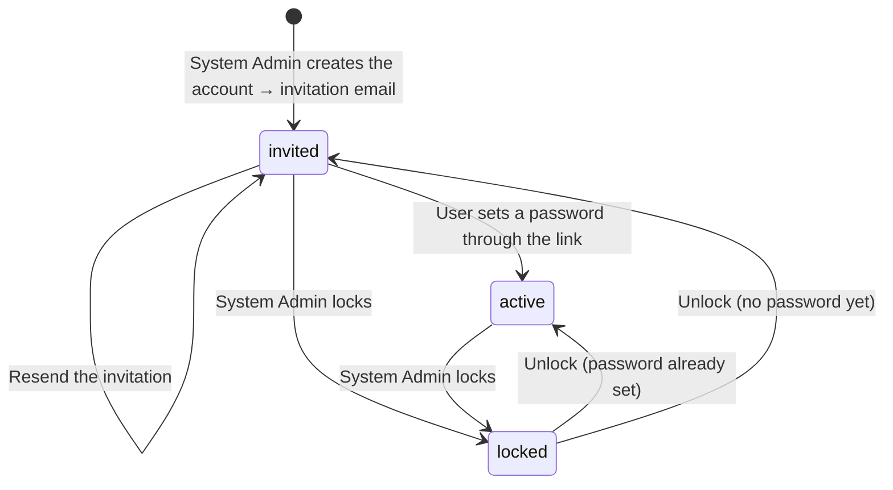

- No self-registration (D-R11). An admin cannot lock themselves, nor lock / demote the **last** active System Admin.
- Setting a password needs a link that is **unused and unexpired** (invitation 72 hours, reset 1 hour); otherwise **400
  `INVALID_ACCOUNT_TOKEN`**. A locked account can still use a valid link but **stays `locked`**; unlocking it afterwards
  makes it `active`.
- Locking revokes every refresh token (section 13); access tokens already issued keep working until they expire (at most
  60 minutes).
- An `active` account no longer gets invitations (409 `ACCOUNT_ALREADY_ACTIVE`) — use "forgot password".
- Signing in to an `invited` account returns `401 INVALID_CREDENTIALS`, exactly like a wrong password.
- No `audit_event` (an account belongs to no commune, D-12): every change is a structured log line naming the admin.

---

## 9. Lamp condition at a pole — `fixture_status`

Belongs to the **pole's position**, not to the lamp (BE-09). It changes along **two** paths, both through a Manager and both
writing through `PoleStatusPublication`: a sweep is **accepted** (every transition below), or a Manager **confirms a pole
photo** (section 10, only the transitions marked "photo"). A publication applies only when its observation is **newer**
than the pole's current one.

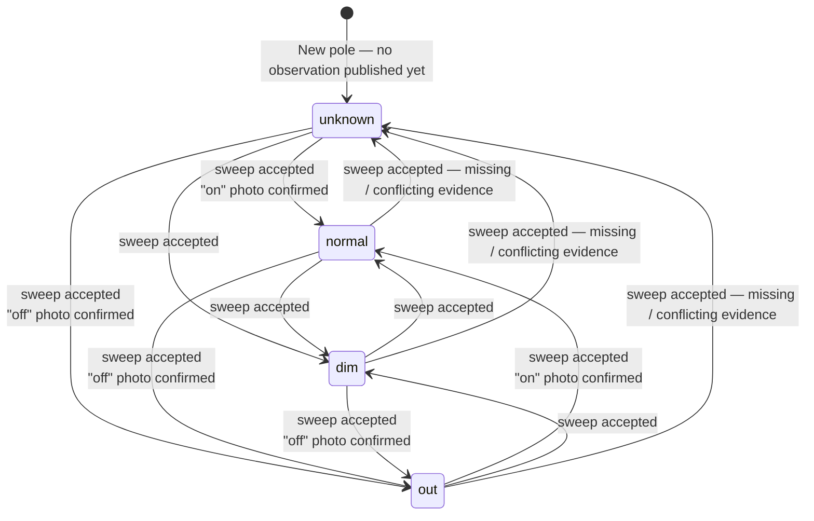

The diagram leaves out **self-loops**: a new publication can keep the classification in any of the four states (for
example an "off" photo on a pole already `out`) — the observation clock still moves forward.

**Classifying one observation** — one pass of the vehicle by the pole (`FrameClassification`), in this order:

| Condition | Result |
|---|---|
| A video gap (`video_gap`), no CV evidence associated with the pole (`no_detection`, `frame_poor`, `on_off_conflict`, …), or the sweep did not pass the pole (`not_observed`) | `unknown` |
| CV sees the lamp **off** | `out` |
| CV sees the lamp **on**, missing baseline / peak lux / trustworthy lux readings | `normal` (brightness not evaluated) |
| CV sees the lamp **on**, peak lux ÷ the pole's own baseline **< `dim_threshold_ratio`** (default 0.80) | `dim` |
| CV sees the lamp **on**, ratio ≥ threshold | `normal` |

At sweep review each pole is published from its **best observation** (non-`unknown` first, then higher CV confidence —
never ranked by brightness). When passes disagree between ON and OFF, the pole is published as `unknown`
(`on_off_conflict`) — `SurveyPublicationRules.Choose`.

- **A photo only knows ON / OFF and cannot measure brightness**, so: "off" → `out`; "on" → `normal` **only** when the pole
  is `out` or `unknown`; a pole that is `normal` / `dim` **keeps** its status and confidence (an "on" photo cannot rebut
  `dim`), and only its observation clock moves forward. A photo never produces `dim` or `unknown`.
- A photo **not newer** than the current observation (`captured_at` ≤ `last_evaluated_at ?? last_seen_at`) can still be
  confirmed but changes **nothing** (`status_reason = not_newer`). Only when a photo is **applied** does the pole's
  `last_sweep_id` become `null` — a photo is not a sweep.
- `unknown` **is not an error**: the latest sweep had no trustworthy evidence for that pole. It is never merged into `out`
  (BE-28).
- ⚠️ The `dim` measurement channel (BH1750 on the vehicle, Registration v1.4) awaits D-R20…D-R23 — the state machine stays
  the same; only how `normal` and `dim` are told apart changes.

---

## 10. Pole photo in a work order — AI ON / OFF, Manager confirmation

The **assigned** engineer photographs a pole of a work order that is `in_progress` (any of the three kinds; the pole must be
in the WO-12 set). There is no status column: the state is derived from `cv_state` (the AI result, written once when the
photo arrives) and `decision` (the Manager's decision). "Awaiting review" is **`decision = null`** on the wire, not a status
value.

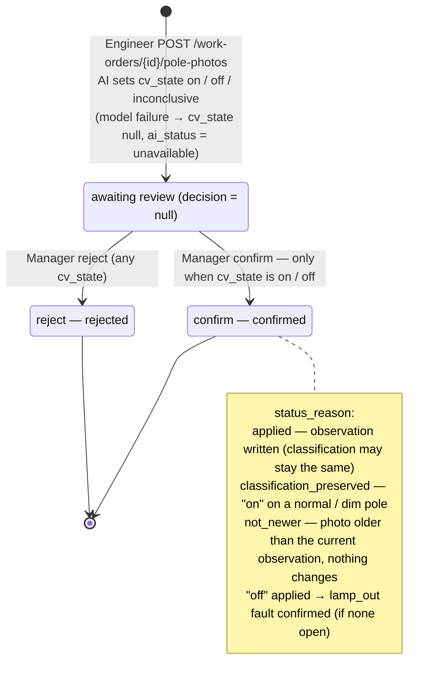

- Re-sending the same `client_op_id` + the same content → 200, returning **the same** photo and AI result (the model is
  not run again); the same key with different content (photo, pole, capture time, coordinates) → 409
  `IDEMPOTENCY_CONFLICT`.
- Decided **once**: a second decision → 409 `POLE_PHOTO_ALREADY_DECIDED`. Confirming an `inconclusive` photo or one with
  no AI result → 409 `POLE_PHOTO_INCONCLUSIVE` (rejecting is allowed). The pole's commune / `data_source` changed after the
  photo arrived → confirming is 409 `POLE_PHOTO_TARGET_CHANGED`, rejecting still works.
- Once the work order is no longer `in_progress` it **takes no new photos**, but the Manager can still decide photos
  already received.
- This photo **does not** replace a repair order's `after` evidence, and writes no `luminance_history` / baseline.
- Audit when a photo arrives: `submitted`, plus `analyzed` (actor `cv`) **only when** the AI returned a result. On decision:
  `confirmed` / `rejected`; plus `applied` when the pole status is written, and `created` (fault) when a `lamp_out` is
  created.

---

## 11. Lamp — fitted / removed

A lamp (`fixture`) is the device mounted on a pole; **its lit condition is not stored here** but on the pole (section 9).
A lamp's lifecycle is only fitted, then removed, derived from `removed_date`.

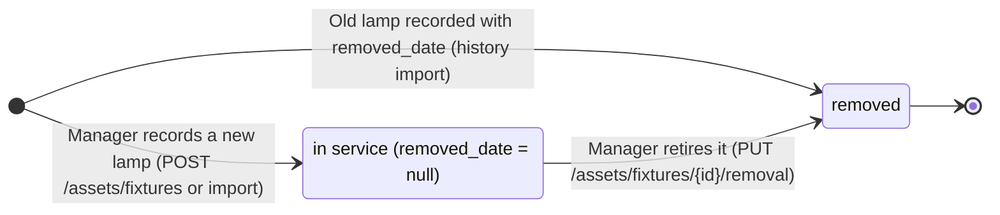

- At most **one** lamp in service per pole (`ux_fixture_pole_id_active`); recording a lamp **in service** on a pole that
  already has one → 409 `POLE_HAS_ACTIVE_FIXTURE`. A lamp recorded with `removed_date` is history and can sit beside the
  one in service. Replacing a lamp = retire the old one, then record the new one.
- `removed_date` ≥ `install_date` (CHECK `ck_fixture_removed_after_install`); retiring twice → **400 `VALIDATION_FAILED`**
  — `removed_date` is equipment history and is not overwritten.
- A lamp has **no** DELETE and no replacing PUT; lamp import only inserts, never updates.
- No `audit_event`: retiring a lamp only changes `removed_date` and stamps `updated_by` / `updated_at`.

---

## 12. Relay mode — `feeder_control.control_mode`

The mode **the device reports** for each relay (circuit), separate from the command lifecycle in section 6: a command is
what the Manager asks for, the mode is what the device says it is running.

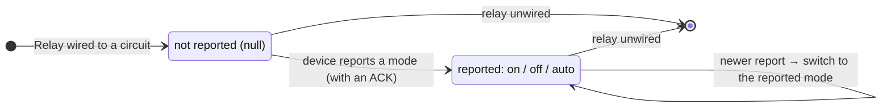

- A mode report comes with a command's ACK. It is written only when the command's `seq` is **above** the current
  `mode_seq` **and** no newer command has been delivered to that relay (D-10) — a late ACK of an old command cannot
  overwrite a newer mode.
- Unwiring deletes the `feeder_control` row; rewiring is a new row that starts at "not reported" (`mode_seq` goes with
  it). The command history survives, so an old ACK is blocked only once a **newer command has been delivered** to that
  relay; rewired with no command delivered yet, an old ACK can still set the mode.

---

## 13. Sign-in session — refresh token

Each sign-in opens a token **chain** (`chain_id`); each refresh **rotates** to a new token in the same chain. The state is
derived from `revoked_at`, `revoked_reason` and two deadlines: the token's sliding expiry and the chain's absolute expiry.

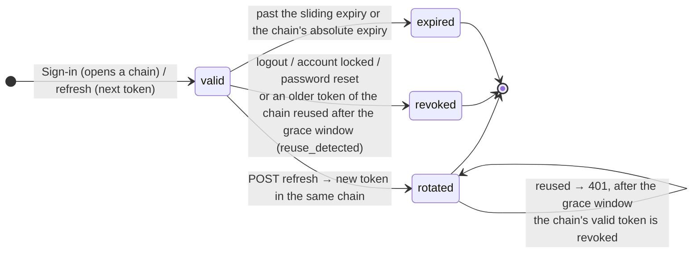

- `revoked_reason`: `rotation`, `logout`, `reuse_detected`, `account_locked`, `password_reset`. A revoked or expired token
  presented again → 401, **nothing** is issued.
- A rotated token presented again always gets 401. Inside the grace window (default 30 seconds, `ReuseGraceSeconds`) that
  is all: the losing request of two concurrent refreshes is not treated as theft. After the window, the server treats the
  token as leaked and revokes the chain's valid token — both sides must sign in again. Reusing a token that was logged out
  never triggers this.
- Locking an account revokes every refresh token (`account_locked`), so a refresh afterwards gets **401**. Signing in to a
  locked account: a wrong password → 401 as usual, the **right** password → 403 `ACCOUNT_LOCKED` (the lock is checked after
  the password so the response does not reveal that the account exists).
- No `audit_event`: a token belongs to no commune; reuse detection is written as a warning log line.
