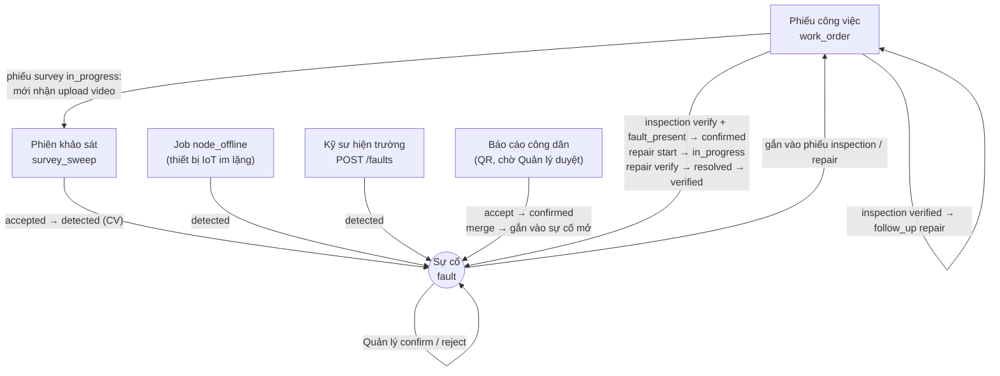
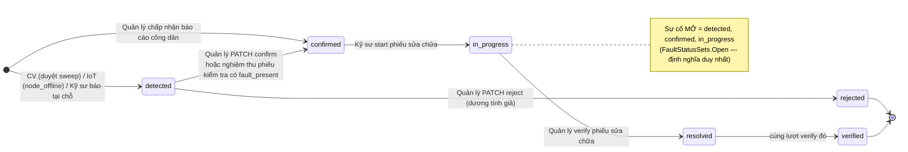
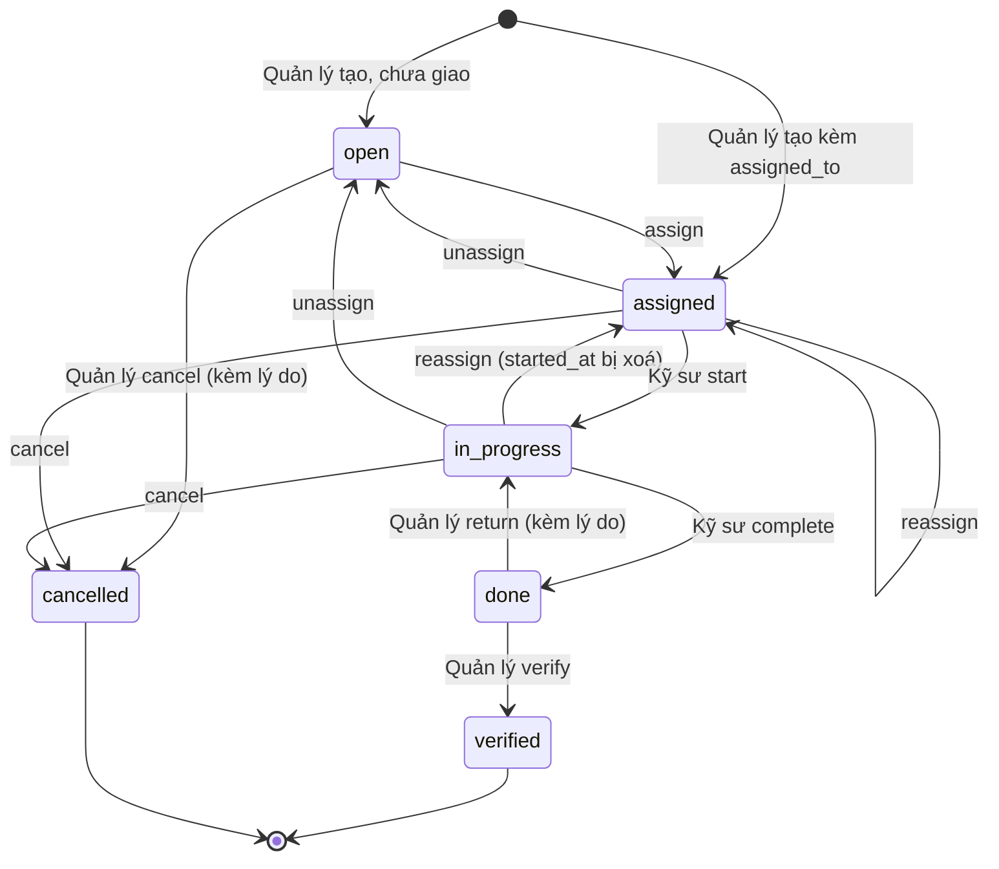
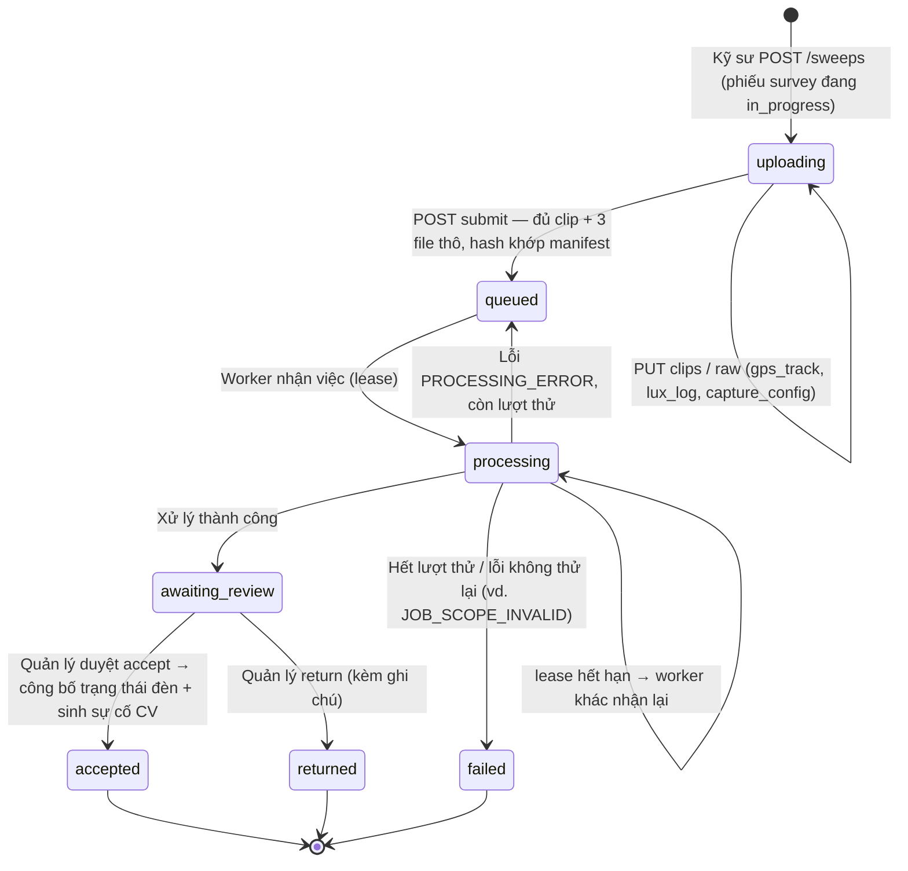
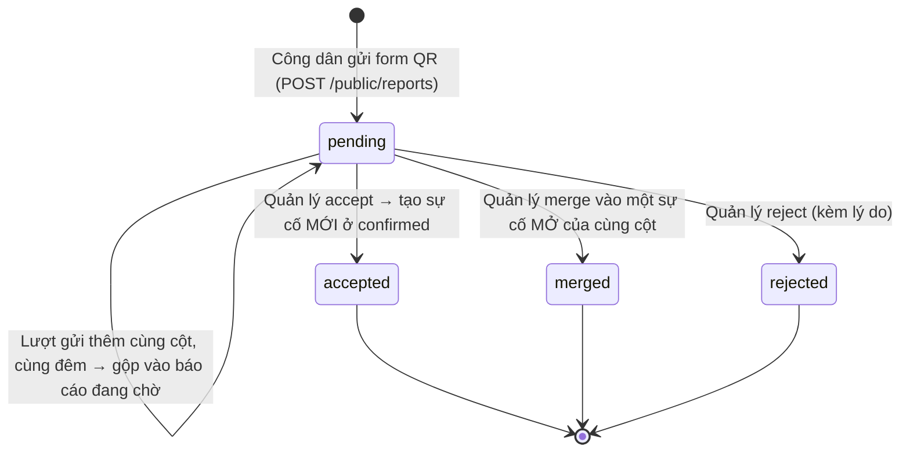
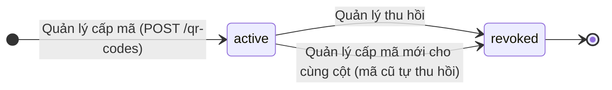
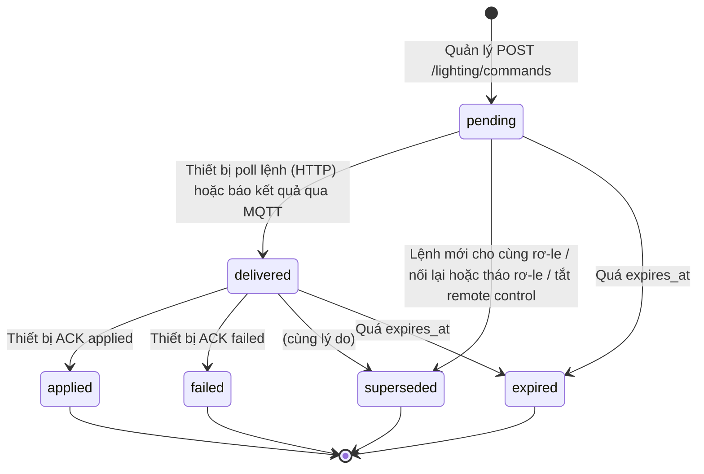
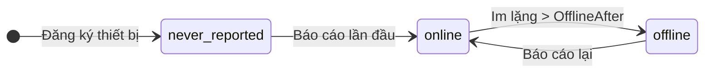
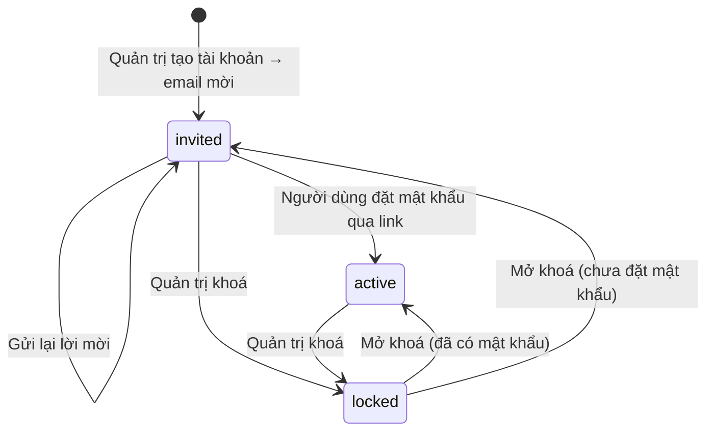
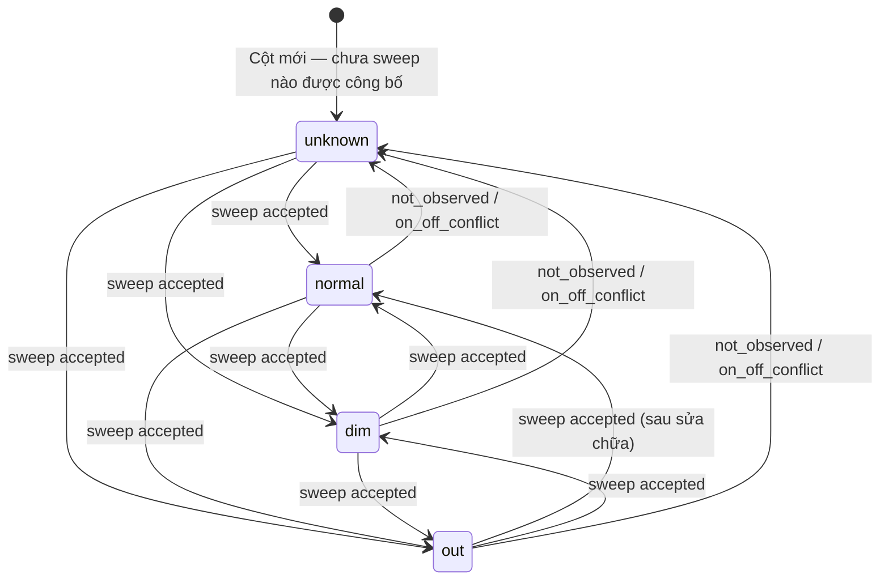

# Sơ đồ trạng thái (State Machine) — LuxMap backend

Vẽ lại từ **code đang chạy trên `dev`** (14/10/2026), không phải từ đặc tả. Mỗi mục nêu file giữ luật chuyển, để ai sửa
luật thì sửa sơ đồ trong cùng PR. Tên trạng thái là **giá trị trên dây** (chuỗi thường, snake_case) — đúng thứ API trả về.

Quy ước chung cho mọi máy dưới đây:

- Chuyển trạng thái không có trong sơ đồ → **409** (`INVALID_STATE_TRANSITION` hoặc mã riêng nêu ở từng mục). API trả sẵn
  `allowed_actions` để FE ẩn nút trước, không để người dùng bấm rồi mới lỗi.
- Mọi chuyển trạng thái do người hoặc engine thực hiện đều ghi **đúng một** dòng audit append-only (BE-23a, D-R13).
- Trạng thái đóng (`[*]` ở cuối) là cuối cùng: không có đường quay lại; việc tiếp theo là một bản ghi **mới**.

| # | Máy trạng thái | Lưu ở | Luật chuyển nằm ở |
|---|---|---|---|
| 0 | Toàn cảnh — các máy nối với nhau thế nào | — | — |
| 1 | Sự cố `fault_status` | `fault.fault_status` | `Faults/FaultTransitions.cs`, `FaultReviewRules.cs` |
| 2 | Phiếu công việc `wo_status` | `work_order.wo_status` | `WorkOrders/WorkOrderRules.cs`, `WorkOrderService.cs` |
| 3 | Phiên khảo sát `survey_sweep.status` | `survey_sweep.status` | `Survey/Ingest/SurveyIngestService.cs`, `Processing/SurveyProcessor.cs`, `Review/SurveyReviewService.cs` |
| 4 | Báo cáo của công dân | `citizen_report.status` | `Citizen/CitizenReviewService.cs`, `PublicReportService.cs` |
| 5 | Mã QR trên cột | `qr_code.revoked_at` | `Citizen/QrCodeService.cs` |
| 6 | Lệnh ON / OFF / AUTO | `lighting_command.status` | `Telemetry/Lighting/LightingCommandService.cs` |
| 7 | Trạng thái thiết bị IoT `node_status` | **không lưu**, tính lúc đọc | `Telemetry/IotOptions.cs` (`StatusAt`), `Jobs/NodeOfflineJob.cs` |
| 8 | Tài khoản người dùng | `is_locked`, `password_set_at` | `Identity/Accounts/UserAdminService.cs` |
| 9 | Tình trạng đèn tại cột `fixture_status` | `pole_current_status` | `Survey/Review/SurveyReviewService.cs` (công bố khi duyệt sweep) |

---

## 0. Toàn cảnh

Sự cố (`fault`) là trung tâm: bốn kênh sinh ra nó, phiếu công việc đưa nó tới đích. Đây là sơ đồ luồng, không phải máy
trạng thái — nó chỉ cho biết máy nào kích hoạt máy nào.

---

## 1. Sự cố — `fault_status`

- `PATCH /faults/{id}` **chỉ** làm được `detected → confirmed | rejected` (`FaultReviewRules.IsReviewTransition`). Ba bước
  sau do **phiếu sửa chữa** đẩy; gửi chúng qua `PATCH` → 409 dù máy trạng thái cho phép.
- `resolved` và `verified` được ghi **cùng một lượt** verify phiếu: `resolved_by` là kỹ sư được giao (thời điểm =
  `completed_at` của phiếu), `verified` là Quản lý nghiệm thu. Hiện không có đường nào dừng ở `resolved`.
- Sự cố đang thuộc một phiếu sửa chữa chưa đóng thì không duyệt được (`allowed_actions` rỗng, WO-10).
- `fault_type` không bao giờ đổi; phân loại lại (`lamp_out` ↔ `lamp_dim`) ghi vào `override_fault_type`, chỉ khi sự cố còn mở.
- ⚠️ Phiếu sửa chữa bị **cancel** khi sự cố đã `in_progress`: sự cố ở lại `in_progress` (liên kết được nhả). Nó vẫn là
  sự cố mở, gắn được vào phiếu sửa chữa mới; `start` của phiếu mới bỏ qua nó, `verify` vẫn đưa nó tới `verified`.

---

## 2. Phiếu công việc — `wo_status`

Ba loại phiếu (`task_kind`): `inspection` (kiểm tra), `repair` (sửa chữa), `survey` (khảo sát đêm) — cùng một máy trạng thái.

| Hành động | Ai | Từ trạng thái | Điều kiện thêm |
|---|---|---|---|
| `assign` / `reassign` / `unassign` / `edit` / `cancel` | Quản lý | `open`, `assigned`, `in_progress` | `cancel` bắt buộc `note` |
| `start` | Kỹ sư **được giao** | `assigned` | phiếu sửa chữa: sự cố `confirmed` → `in_progress` |
| `complete` | Kỹ sư được giao | `in_progress` | `note` ≥ 10 ký tự; sửa chữa phải có ảnh `after` (409 `AFTER_EVIDENCE_REQUIRED`); kiểm tra phải có `fault_outcomes` cho mọi sự cố |
| `return` | Quản lý | `done` | bắt buộc `note` |
| `verify` | Quản lý | `done` | sửa chữa: sự cố → `resolved` → `verified`; kiểm tra: sự cố `fault_present` + `detected` → `confirmed` |
| `follow_up` | Quản lý | `verified` | chỉ phiếu **kiểm tra** sinh được phiếu **sửa chữa** nối chuỗi (FR-2) |

- `verified` và `cancelled` đặt `closed_at` và **nhả** mọi liên kết sự cố — sự cố đó gắn được vào phiếu khác.
- Phiếu khảo sát chỉ nhận upload video khi đang `in_progress` (xem mục 3).
- Job `work_order_overdue` (BE-26) báo quá hạn cho phiếu `open | assigned | in_progress` — chỉ thông báo, **không** đổi trạng thái.

---

## 3. Phiên khảo sát — `survey_sweep.status`

Sweep có hai cột: `status` (vòng đời đầy đủ, hiển thị) và `processing_status` (chỉ phần xử lý:
`not_started | queued | processing | succeeded | failed`). Sơ đồ theo `status`.

- `submit` thiếu file → 409 `UPLOAD_INCOMPLETE`; hash lệch → 409 `MANIFEST_MISMATCH`. Gửi lại `submit` y hệt sau khi đã
  qua `uploading` là idempotent (trả lại kết quả cũ).
- Duyệt sweep không ở `awaiting_review` → 409 `SWEEP_ALREADY_REVIEWED`; lệch `expected_version` → 409 `VERSION_CONFLICT`.
- **Chỉ `accepted` mới công bố** kết quả lên `pole_current_status` (mục 9) và sinh sự cố `lamp_out` / `lamp_dim`.
  `returned` chỉ ghi quyết định; khảo sát lại là một sweep mới.

---

## 4. Báo cáo của công dân — `citizen_report.status`

- Báo cáo của dân **không bao giờ** tự thành sự cố — luôn qua Quản lý (D-R1).
- Mỗi quyết định gửi kèm `submission_count` đã đọc; có lượt gửi mới chen vào → 409 `CITIZEN_REPORT_CHANGED`.
- `merge` chỉ vào sự cố mở (`detected | confirmed | in_progress`) **trên chính cột đó**, ngược lại 409 `FAULT_NOT_MERGEABLE`.

---

## 5. Mã QR trên cột

- Mỗi cột tối đa **một** mã `active` (`ux_qr_code_pole_id_active`). Thu hồi lần hai → 409 `QR_CODE_ALREADY_REVOKED`.
- Mã `revoked` không gửi báo cáo được nữa; lượt gửi đang chạy khi mã bị thu hồi thì thu hồi thắng.

---

## 6. Lệnh điều khiển đèn ON / OFF / AUTO — `lighting_command.status`

Chỉ thiết bị **testbed** (`supports_remote_control = true`), chỉ Quản lý bấm (D-R7). Một lần bấm sinh một lệnh cho mỗi rơ-le.

- ACK trên lệnh còn `pending` → 409 `COMMAND_NOT_DELIVERED` (phải lấy lệnh trước).
- ACK trên lệnh đã `expired` / `superseded` → 409 `COMMAND_CLOSED`, nhưng báo cáo **vẫn được lưu** vào lịch sử: thiết bị
  nói thật về rơ-le của nó. `control_mode` của rơ-le chỉ đổi khi báo cáo mới hơn mọi lệnh đã giao sau đó.
- `expired` được ghi khi có lượt ghi chạm thiết bị; lúc đọc, lệnh mở đã quá hạn **hiển thị** là `expired` ngay.

---

## 7. Thiết bị IoT — `node_status`

Không lưu trong DB: tính từ `last_report_at` và `Iot:OfflineAfter` (mặc định 1 giờ) mỗi lần đọc.

- Đúng bằng ngưỡng vẫn là `online`.
- Job `node_offline` (BE-26) sinh **một** sự cố `node_offline` (`detected`, `source_channel = iot`) cho mỗi lần thiết bị
  vượt ngưỡng. Thiết bị online lại **không** tự đóng sự cố — Quản lý xử lý như mọi sự cố khác.

---

## 8. Tài khoản người dùng

Không có cột trạng thái: suy từ `is_locked` và `password_set_at` lúc đọc (`UserAdminService`, trường `status` của `/admin/users`).

- Không tự đăng ký (D-R11). Không khoá được chính mình; không khoá / hạ vai trò **Quản trị cuối cùng** đang hoạt động.
- Tài khoản `active` không nhận lời mời nữa (409 `ACCOUNT_ALREADY_ACTIVE`) — dùng "quên mật khẩu".
- Đăng nhập tài khoản `invited` trả `401 INVALID_CREDENTIALS`, y như sai mật khẩu.

---

## 9. Tình trạng đèn tại cột — `fixture_status`

Thuộc **vị trí cột**, không thuộc bóng (BE-09). Chỉ đổi khi một sweep được **accept**; mỗi lần công bố ghi đè giá trị cũ
bằng kết quả của lần khảo sát mới nhất phủ cột đó.

- `unknown` **không phải lỗi**: sweep gần nhất không quan sát được cột (`not_observed`) hoặc các lượt đi qua cho kết quả
  ON/OFF trái nhau (`on_off_conflict`). Không bao giờ gộp vào `out` (BE-28).
- Phân loại theo **tỉ lệ so với baseline của chính cột đó** (`dim_threshold_ratio` 0.80, `out_threshold_ratio` 0.15,
  cấu hình được). ⚠️ Phiếu v1.4 đổi kênh đo `dim` sang BH1750 trên xe (D-R20…D-R23, **chưa chốt**) — sơ đồ trạng thái
  không đổi, chỉ đổi cách quyết định giữa `normal` và `dim`.
