# Sơ đồ trạng thái (State Machine) — LuxMap backend

Vẽ lại từ **code đang chạy trên `dev`**, không phải từ đặc tả: bản đầu 14/10/2026, mục 10 thêm 16/10/2026 sau
POLE-PHOTO-AI; **20/10/2026 đối chiếu lại toàn bộ với code** (review chỉ-đọc của Codex, từng phát hiện được kiểm lại
trên code) và thêm mục 11–13. Mỗi mục nêu file giữ luật chuyển, để ai sửa luật thì sửa sơ đồ trong cùng PR. Tên trạng
thái là **giá trị trên dây** (chuỗi thường, snake_case) — đúng thứ API trả về; ngoại lệ ghi rõ ở từng mục.

Quy ước chung cho mọi máy dưới đây:

- Chuyển trạng thái không có trong sơ đồ → **409** (`INVALID_STATE_TRANSITION` hoặc mã riêng nêu ở từng mục). Dữ liệu
  gửi kèm sai (thiếu trường, link hết hạn…) là **400**, không phải 409.
- Sự cố, phiếu công việc và báo cáo của công dân trả sẵn **`allowed_actions`** để FE ẩn nút trước, không để người dùng bấm
  rồi mới lỗi. Các máy khác không có trường này.
- Chuyển trạng thái nghiệp vụ ghi vào **audit append-only** (BE-23a, D-R13): mỗi lượt lưu **đúng một** dòng, một thao tác
  có thể gồm nhiều lượt lưu (ví dụ nhận ảnh cột: `submitted` rồi `analyzed`). Ngoại lệ: tài khoản người dùng (mục 8) và
  refresh token (mục 13) không thuộc xã nào nên chỉ ghi structured log; bóng đèn (mục 11) chỉ đóng dấu `updated_by` /
  `updated_at` trên chính dòng đó.
- Trạng thái đóng (`[*]` ở cuối) là cuối cùng: không có đường quay lại; việc tiếp theo là một bản ghi **mới**.

| # | Máy trạng thái | Lưu ở | Luật chuyển nằm ở |
|---|---|---|---|
| 0 | Toàn cảnh — các máy nối với nhau thế nào | — | — |
| 1 | Sự cố `fault_status` | `fault.fault_status` | `Faults/FaultTransitions.cs`, `FaultReviewRules.cs` |
| 2 | Phiếu công việc `wo_status` | `work_order.wo_status` | `WorkOrders/WorkOrderRules.cs`, `WorkOrderService.cs` |
| 3 | Phiên khảo sát `survey_sweep.status` | `survey_sweep.status`, `processing_status` | `Survey/Ingest/SurveyIngestService.cs`, `Processing/SurveyProcessor.cs`, `Review/SurveyReviewService.cs` |
| 4 | Báo cáo của công dân | `citizen_report.status` | `Citizen/CitizenReviewService.cs`, `PublicReportService.cs` |
| 5 | Mã QR trên cột | `qr_code.revoked_at` | `Citizen/QrCodeService.cs` |
| 6 | Lệnh ON / OFF / AUTO | `lighting_command.status` | `Telemetry/Lighting/LightingCommandService.cs`, `Telemetry/Mqtt/MqttLightingHandler.cs` |
| 7 | Trạng thái thiết bị IoT `node_status` | **không lưu**, tính lúc đọc | `Telemetry/IotOptions.cs` (`StatusAt`), `Jobs/NodeOfflineJob.cs` |
| 8 | Tài khoản người dùng | `is_locked`, `password_set_at` | `Identity/Accounts/UserAdminService.cs`, `PasswordService.cs` |
| 9 | Tình trạng đèn tại cột `fixture_status` | `pole_current_status` | `Survey/Processing/Frames/FrameClassification.cs` (phân loại), `Survey/Review/SurveyReviewService.cs` (duyệt sweep), `ReviewedPolePhotoPublisher.cs` (xác nhận ảnh cột); cả hai ghi qua `PoleStatusPublication.cs` |
| 10 | Ảnh cột trong phiếu (AI ON/OFF) | `work_order_pole_photo.decision`, `cv_state` | `WorkOrders/WorkOrderPolePhotoService.cs`, `Survey/Review/ReviewedPolePhotoPublisher.cs` |
| 11 | Bóng đèn — lắp / gỡ | `fixture.removed_date` | `Assets/Crud/AssetCrudService.cs` |
| 12 | Chế độ rơ-le `control_mode` | `feeder_control.control_mode`, `mode_seq` | `Telemetry/Lighting/LightingCommandService.cs` (`RecordAsync`) |
| 13 | Phiên đăng nhập — refresh token | `refresh_token.revoked_at`, `revoked_reason` | `Identity/Auth/AuthService.cs`, `Accounts/AccountTokens.cs` |

---

## 0. Toàn cảnh

Sự cố (`fault`) là trung tâm: năm kênh sinh ra nó, phiếu công việc đưa nó tới đích. Đây là sơ đồ luồng, không phải máy
trạng thái — nó chỉ cho biết máy nào kích hoạt máy nào.

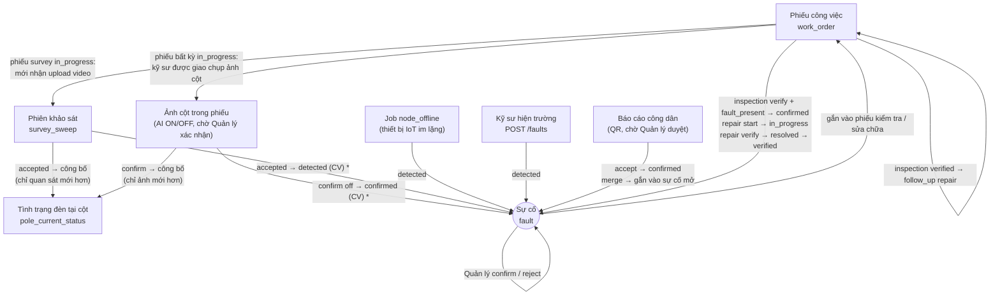

- `*` Sweep và ảnh cột chỉ sinh sự cố khi quan sát **được áp** (mới hơn quan sát hiện tại của cột) và cột **chưa** có sự cố
  mở cùng loại — chi tiết ở mục 1.
- Phiếu kiểm tra nhận mọi sự cố mở; phiếu sửa chữa chỉ nhận sự cố `confirmed` / `in_progress`.
- Một sự cố chỉ thuộc **một** phiếu chưa đóng tại một thời điểm (409 `FAULT_ALREADY_IN_WORK_ORDER`); phiếu `verified` /
  `cancelled` nhả liên kết (`work_order_fault.released_at`) để sự cố gắn được vào phiếu khác.

---

## 1. Sự cố — `fault_status`

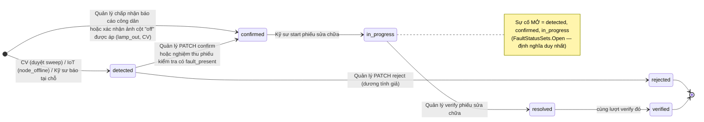

- `PATCH /faults/{id}` **chỉ** làm được `detected → confirmed | rejected` (`FaultReviewRules.IsReviewTransition`). Ba bước
  sau do **phiếu sửa chữa** đẩy; gửi chúng qua `PATCH` → 409 dù máy trạng thái cho phép.
- `resolved` và `verified` được ghi **cùng một lượt** verify phiếu: `resolved_by` là kỹ sư được giao (thời điểm =
  `completed_at` của phiếu), `verified` là Quản lý nghiệm thu. Hiện không có đường nào dừng ở `resolved`.
- Sự cố đang thuộc một phiếu sửa chữa chưa đóng thì không duyệt được (`allowed_actions` rỗng, WO-10).
- `fault_type` không bao giờ đổi; phân loại lại (`lamp_out` ↔ `lamp_dim`) ghi vào `override_fault_type`, chỉ khi sự cố còn mở.
- **Khử trùng lặp khi sinh tự động:** sweep và ảnh cột chỉ sinh sự cố khi cột **chưa** có sự cố mở cùng loại hiệu lực
  (`override_fault_type ?? fault_type`). Duyệt sweep sinh `lamp_out` / `lamp_dim` ở `detected`; xác nhận ảnh "off" sinh
  `lamp_out` ở thẳng `confirmed` vì Quản lý đã xem ảnh (`origin_pole_photo_id` trỏ về ảnh). Cả hai chỉ sinh khi quan sát
  **được áp** (mới hơn quan sát hiện tại của cột, mục 9). Ảnh "on" **không** tự đóng sự cố nào.
- ⚠️ Phiếu sửa chữa bị **cancel** khi sự cố đã `in_progress`: sự cố ở lại `in_progress` (liên kết được nhả). Nó vẫn là
  sự cố mở, gắn được vào phiếu sửa chữa mới; `start` của phiếu mới bỏ qua nó, `verify` vẫn đưa nó tới `verified`.

---

## 2. Phiếu công việc — `wo_status`

Ba loại phiếu (`task_kind`): `inspection` (kiểm tra), `repair` (sửa chữa), `survey` (khảo sát đêm) — cùng một máy trạng thái.

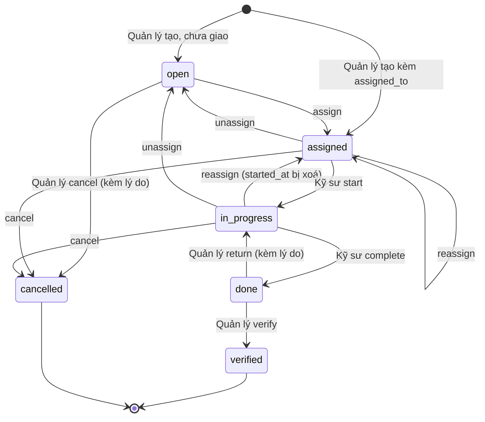

| Hành động | Ai | Từ trạng thái | Điều kiện thêm |
|---|---|---|---|
| `assign` / `reassign` / `unassign` / `edit` / `cancel` | Quản lý | `open`, `assigned`, `in_progress` | người được giao phải là Kỹ sư hiện trường đang hoạt động, có đủ xã của phiếu (phiếu khảo sát: đủ xã của mọi tuyến), ngược lại 409 `ASSIGNEE_NOT_ELIGIBLE`; giao lại đúng người đang giữ thì không đổi gì; `cancel` bắt buộc `note` |
| `start` | Kỹ sư **được giao** | `assigned` | phiếu sửa chữa: sự cố `confirmed` → `in_progress` |
| `complete` | Kỹ sư được giao | `in_progress` | `report_note` ≥ 10 ký tự (sau khi bỏ khoảng trắng hai đầu); sửa chữa phải có ảnh `after` (409 `AFTER_EVIDENCE_REQUIRED`); kiểm tra phải có `fault_outcomes` cho mọi sự cố |
| `return` | Quản lý | `done` | bắt buộc `note` |
| `verify` | Quản lý | `done` | sửa chữa: sự cố → `resolved` → `verified`; kiểm tra: sự cố `fault_present` + `detected` → `confirmed` |
| `follow_up` | Quản lý | `verified` | chỉ phiếu **kiểm tra** sinh được phiếu **sửa chữa** nối chuỗi (FR-2); phải có ít nhất một sự cố `fault_present` (409 `NOTHING_TO_FOLLOW_UP`), sự cố chọn phải còn hợp lệ cho sửa chữa (409 `FAULT_STATUS_NOT_ELIGIBLE`) và chưa thuộc phiếu khác (409 `FAULT_ALREADY_IN_WORK_ORDER`) |

- `verified` và `cancelled` đặt `closed_at` và **nhả** mọi liên kết sự cố — sự cố đó gắn được vào phiếu khác.
- Phiếu sửa chữa chỉ nhận sự cố `confirmed` / `in_progress`; phiếu kiểm tra nhận mọi sự cố mở; phiếu khảo sát không nhận sự cố.
- Phiếu khảo sát chỉ nhận upload video khi đang `in_progress` (xem mục 3).
- Job `work_order_overdue` (BE-26) báo quá hạn cho phiếu `open | assigned | in_progress` — chỉ thông báo, **không** đổi trạng thái.

---

## 3. Phiên khảo sát — `survey_sweep.status`

Sweep có hai cột: `status` (vòng đời đầy đủ, hiển thị) và `processing_status` (chỉ phần xử lý của worker). Sơ đồ theo
`status`; bảng dưới sơ đồ cho biết `processing_status` tương ứng.

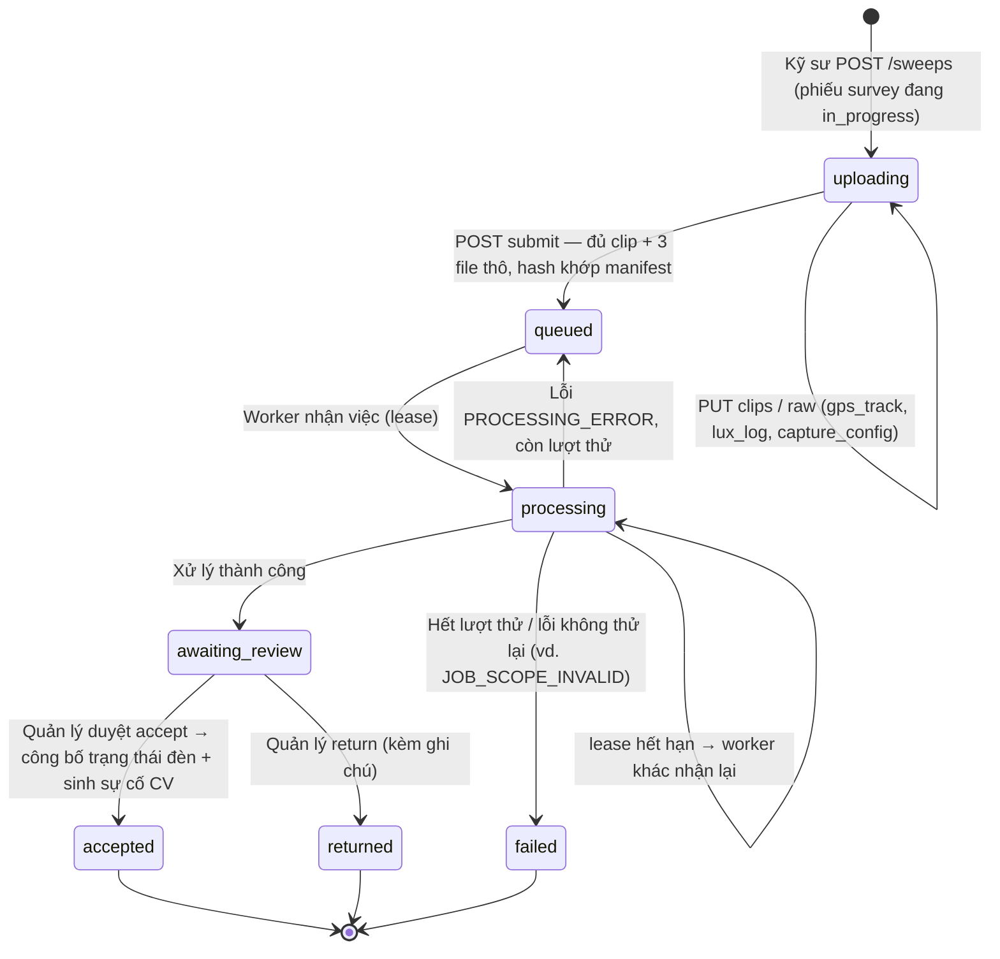

| `status` | `processing_status` |
|---|---|
| `uploading` | `not_started` |
| `queued` | `queued` |
| `processing` | `processing` |
| `awaiting_review`, `accepted`, `returned` | `succeeded` — duyệt không đổi kết quả xử lý |
| `failed` | `failed` |

- `submit` thiếu file → 409 `UPLOAD_INCOMPLETE`; hash lệch → 409 `MANIFEST_MISMATCH`. Gửi lại `submit` y hệt sau khi đã
  qua `uploading` là idempotent (trả lại kết quả cũ).
- Thứ tự kiểm khi duyệt: `run_id` phải là lượt xử lý **`succeeded`** của chính sweep đó (409 `INVALID_REVIEW_RUN`) →
  gửi lại **cùng `client_op_id`, cùng nội dung** trả kết quả cũ, cùng khoá khác nội dung → 409 `IDEMPOTENCY_CONFLICT` →
  sweep không ở `awaiting_review` → 409 `SWEEP_ALREADY_REVIEWED` → lệch `expected_version` → 409 `VERSION_CONFLICT`.
- `accept` còn đòi cột trong sweep **vẫn** cùng xã / `data_source` như lúc xử lý (409 `SURVEY_SCOPE_CHANGED`).
- **Chỉ `accepted` mới công bố** kết quả lên `pole_current_status` (mục 9) và sinh sự cố `lamp_out` / `lamp_dim` (theo
  luật khử trùng lặp ở mục 1). `returned` chỉ ghi quyết định; khảo sát lại là một sweep mới.
- ⚠️ Sweep `data_source = field` hiện thất bại ở bước `video_clock` với `VIDEO_DEVICE_MAPPING_PENDING` (cổng D-07 chưa gỡ);
  sweep đã `failed` không có đường xếp lại hàng.

---

## 4. Báo cáo của công dân — `citizen_report.status`

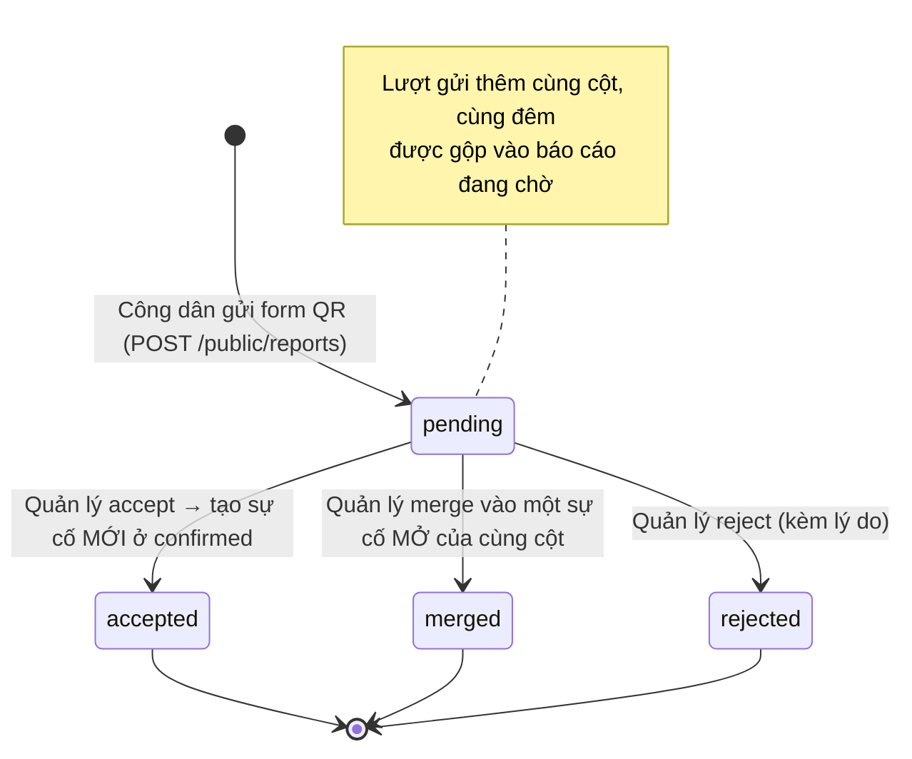

- Báo cáo của dân **không bao giờ** tự thành sự cố — luôn qua Quản lý (D-R1).
- Mỗi quyết định gửi kèm `submission_count` đã đọc; có lượt gửi mới chen vào → 409 `CITIZEN_REPORT_CHANGED`. Quyết định
  **một lần**: lần hai → 409 `CITIZEN_REPORT_ALREADY_DECIDED`.
- `accept` chỉ tạo `lamp_out` / `lamp_dim` khi báo cáo có lượt gửi đúng loại đó (409 `CITIZEN_REPORT_NOT_ACCEPTABLE`) và
  cột **chưa** có sự cố mở cùng loại (409 `OPEN_FAULT_EXISTS` — khi đó dùng `merge`).
- `merge` chỉ vào sự cố mở (`detected | confirmed | in_progress`) **trên chính cột đó**, ngược lại 409 `FAULT_NOT_MERGEABLE`.

---

## 5. Mã QR trên cột

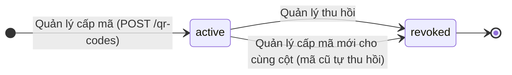

- Mỗi cột tối đa **một** mã `active` (`ux_qr_code_pole_id_active`). Thu hồi lần hai → 409 `QR_CODE_ALREADY_REVOKED`.
- Mã `revoked` không gửi báo cáo được nữa. Lượt gửi và lượt thu hồi cùng khoá hàng `pole`; lượt gửi kiểm lại mã **dưới
  khoá**, nên mã đã bị thu hồi lúc đó thì lượt gửi bị từ chối.

---

## 6. Lệnh điều khiển đèn ON / OFF / AUTO — `lighting_command.status`

Chỉ thiết bị **testbed** (`supports_remote_control = true`), chỉ Quản lý bấm (D-R7). Một lần bấm sinh một lệnh cho mỗi
rơ-le đã nối của thiết bị đã cấp bí mật; không có rơ-le nào điều khiển được → 409 `NO_CONTROLLABLE_RELAY`.

- Qua **HTTP**, ACK trên lệnh còn `pending` → 409 `COMMAND_NOT_DELIVERED` (phải lấy lệnh trước). Qua **MQTT**, ACK hợp
  lệ trên lệnh `pending` tự chuyển sang `delivered` rồi áp kết quả.
- ACK phải đúng `seq` của lệnh; `applied` phải báo đúng chế độ đã yêu cầu, `failed` phải có `error` — sai là 400. ACK cuối
  gửi lại y hệt → 200; cùng lệnh khác nội dung → 409.
- ACK trên lệnh đã `expired` / `superseded` → 409 `COMMAND_CLOSED`, nhưng báo cáo **vẫn được lưu** vào lịch sử: thiết bị
  nói thật về rơ-le của nó. Chế độ rơ-le đổi theo luật ở mục 12.
- `expired` được ghi khi có lượt ghi chạm thiết bị; lúc đọc, lệnh mở đã quá hạn **hiển thị** là `expired` ngay.

---

## 7. Thiết bị IoT — `node_status`

Không lưu trong DB: tính từ `last_report_at` và `Iot:OfflineAfter` (mặc định 1 giờ) mỗi lần đọc.

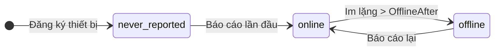

- Đúng bằng ngưỡng vẫn là `online`.
- Job `node_offline` (BE-26) sinh **một** sự cố `node_offline` (`detected`, `source_channel = iot`) cho mỗi lần thiết bị
  vượt ngưỡng. Thiết bị online lại **không** tự đóng sự cố — Quản lý xử lý như mọi sự cố khác.

---

## 8. Tài khoản người dùng

Không có cột trạng thái: suy từ `is_locked` và `password_set_at` lúc đọc (`UserAdminService`, trường `status` của `/admin/users`).

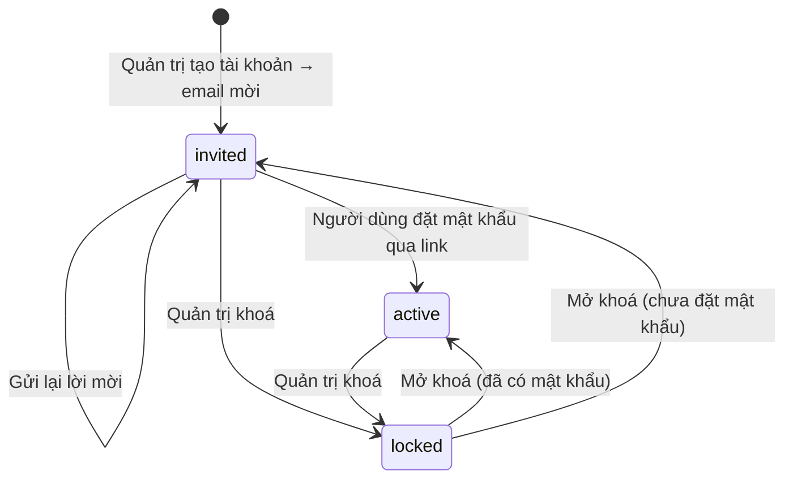

- Không tự đăng ký (D-R11). Không khoá được chính mình; không khoá / hạ vai trò **Quản trị cuối cùng** đang hoạt động.
- Đặt mật khẩu cần link **chưa dùng, chưa hết hạn** (mời 72 giờ, đặt lại 1 giờ); sai → **400 `INVALID_ACCOUNT_TOKEN`**.
  Tài khoản đang khoá vẫn dùng được link còn hạn nhưng **vẫn `locked`**; mở khoá sau đó thì thành `active`.
- Khoá tài khoản thu hồi mọi refresh token (mục 13); access token đã cấp vẫn dùng được tới khi hết hạn (tối đa 60 phút).
- Tài khoản `active` không nhận lời mời nữa (409 `ACCOUNT_ALREADY_ACTIVE`) — dùng "quên mật khẩu".
- Đăng nhập tài khoản `invited` trả `401 INVALID_CREDENTIALS`, y như sai mật khẩu.
- Không ghi `audit_event` (tài khoản không thuộc xã nào, D-12): mỗi thay đổi là một dòng structured log nêu Quản trị đã làm.

---

## 9. Tình trạng đèn tại cột — `fixture_status`

Thuộc **vị trí cột**, không thuộc bóng (BE-09). Đổi theo **hai** đường, cả hai đều phải qua Quản lý và cùng ghi qua
`PoleStatusPublication`: một sweep được **accept** (mọi chuyển dưới đây), hoặc Quản lý **xác nhận một ảnh cột** (mục 10,
chỉ các chuyển ghi "ảnh"). Lần công bố chỉ áp khi quan sát của nó **mới hơn** quan sát hiện tại của cột.

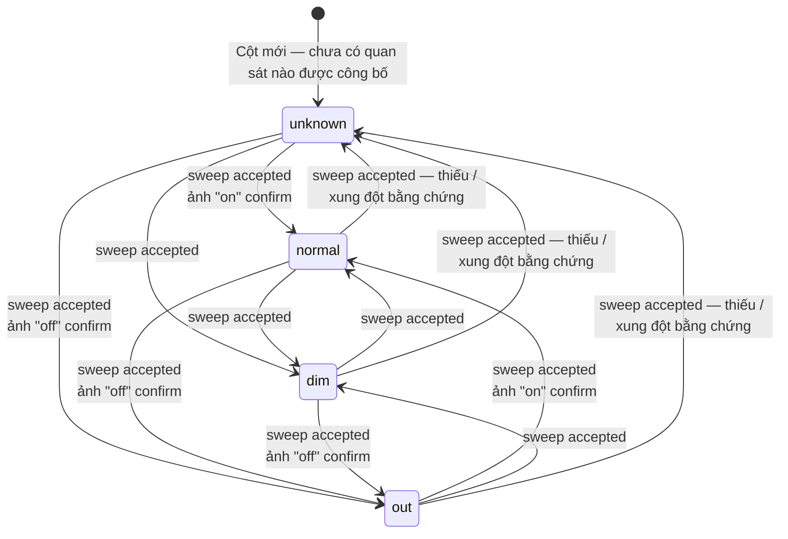

Sơ đồ lược các **vòng tại chỗ**: một công bố mới có thể giữ nguyên phân loại ở cả bốn trạng thái (ví dụ ảnh "off" trên cột
đang `out`) — mốc quan sát vẫn dời lên.

**Phân loại một quan sát** — một lượt xe đi qua cột (`FrameClassification`), theo thứ tự:

| Điều kiện | Kết quả |
|---|---|
| Có khoảng hở video (`video_gap`), không gán được bằng chứng CV cho cột (`no_detection`, `frame_poor`, `on_off_conflict`, …), hoặc sweep không đi qua cột (`not_observed`) | `unknown` |
| CV thấy đèn **tắt** | `out` |
| CV thấy đèn **sáng**, thiếu baseline / đỉnh lux / số đo lux tin được | `normal` (không đánh giá độ sáng) |
| CV thấy đèn **sáng**, đỉnh lux ÷ baseline của chính cột **< `dim_threshold_ratio`** (mặc định 0.80) | `dim` |
| CV thấy đèn **sáng**, tỉ lệ ≥ ngưỡng | `normal` |

Khi duyệt sweep, mỗi cột được công bố theo **quan sát tốt nhất** của nó (ưu tiên quan sát không `unknown`, rồi độ tin cậy CV
cao hơn — không bao giờ xếp theo độ sáng). Riêng khi các lượt đi qua cho ON và OFF trái nhau, cột được công bố `unknown`
(`on_off_conflict`) — `SurveyPublicationRules.Choose`.

- **Ảnh chỉ biết ON / OFF, không đo được độ sáng**, nên: "off" → `out`; "on" → `normal` **chỉ** khi cột đang `out`
  hoặc `unknown`; cột đang `normal` / `dim` thì **giữ nguyên** trạng thái và độ tin cậy (ảnh "on" không bác bỏ được
  `dim`), chỉ dời mốc quan sát lên. Ảnh không bao giờ sinh `dim` hay `unknown`.
- Ảnh chụp **không mới hơn** quan sát hiện tại (`captured_at` ≤ `last_evaluated_at ?? last_seen_at`) vẫn xác nhận
  được nhưng **không** đổi gì (`status_reason = not_newer`). Chỉ khi ảnh **được áp**, `last_sweep_id` của cột mới thành
  `null` — ảnh không phải một sweep.
- `unknown` **không phải lỗi**: sweep gần nhất không có bằng chứng đủ tin cho cột đó. Không bao giờ gộp vào `out` (BE-28).
- ⚠️ Kênh đo `dim` (BH1750 trên xe, Phiếu v1.4) còn chờ chốt D-R20…D-R23 — sơ đồ trạng thái không đổi, chỉ đổi cách quyết
  định giữa `normal` và `dim`.

---

## 10. Ảnh cột trong phiếu — AI ON / OFF, Quản lý xác nhận

Kỹ sư **được giao** chụp một cột thuộc phiếu đang `in_progress` (cả ba loại phiếu; cột phải thuộc tập WO-12). Không có cột
trạng thái riêng: suy từ `cv_state` (kết quả AI, ghi một lần lúc nhận ảnh) và `decision` (quyết định của Quản lý).
"Chờ duyệt" là **`decision = null`** trên dây, không phải một giá trị trạng thái.

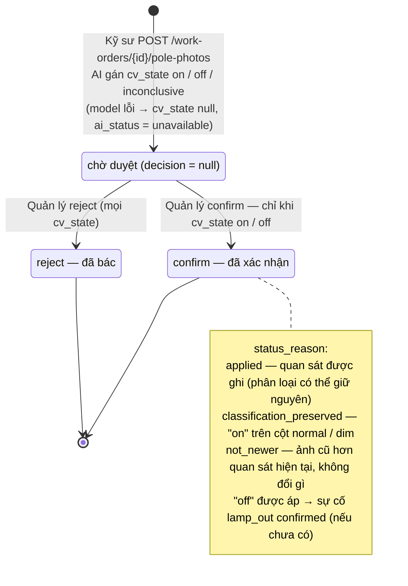

- Gửi lại cùng `client_op_id` + cùng nội dung → 200, trả **đúng** ảnh và kết quả AI cũ (không chạy model lại);
  cùng khoá khác nội dung (ảnh, cột, giờ chụp, toạ độ) → 409 `IDEMPOTENCY_CONFLICT`.
- Quyết định **một lần**: lần hai → 409 `POLE_PHOTO_ALREADY_DECIDED`. Xác nhận ảnh `inconclusive` hoặc chưa có kết quả
  AI → 409 `POLE_PHOTO_INCONCLUSIVE` (bác thì được). Cột đổi xã / `data_source` sau khi nhận ảnh → xác nhận 409
  `POLE_PHOTO_TARGET_CHANGED`, bác vẫn được.
- Phiếu không còn `in_progress` thì **không nhận ảnh mới**, nhưng Quản lý vẫn quyết định được ảnh đã nhận.
- Ảnh này **không** thay ảnh `after` của phiếu sửa chữa, không ghi `luminance_history` / baseline.
- Audit lúc nhận ảnh: `submitted`, thêm `analyzed` (actor `cv`) **chỉ khi** AI trả kết quả. Lúc quyết định: `confirmed` /
  `rejected`; thêm `applied` khi trạng thái cột được ghi, `created` (sự cố) khi sinh `lamp_out`.

---

## 11. Bóng đèn — lắp / gỡ

Bóng (`fixture`) là thiết bị gắn trên cột; **tình trạng sáng không nằm ở đây** mà ở cột (mục 9). Vòng đời của bóng chỉ là
lắp rồi gỡ, suy từ `removed_date`.

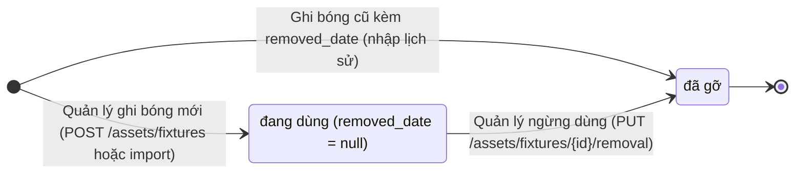

- Mỗi cột tối đa **một** bóng đang dùng (`ux_fixture_pole_id_active`); ghi bóng **đang dùng** vào cột đã có bóng → 409
  `POLE_HAS_ACTIVE_FIXTURE`. Bóng ghi kèm `removed_date` là lịch sử, đứng cạnh bóng đang dùng được. Thay bóng = ngừng dùng
  bóng cũ rồi ghi bóng mới.
- `removed_date` ≥ `install_date` (CHECK `ck_fixture_removed_after_install`); gỡ lần hai → **400 `VALIDATION_FAILED`** —
  `removed_date` là lịch sử thiết bị, không ghi đè.
- Bóng **không** có DELETE và không có PUT thay thế; import bóng chỉ chèn, không cập nhật.
- Không ghi `audit_event`: gỡ bóng chỉ đổi `removed_date` và đóng dấu `updated_by` / `updated_at`.

---

## 12. Chế độ rơ-le — `feeder_control.control_mode`

Chế độ **thiết bị báo** cho từng rơ-le (mạch điện), khác với vòng đời lệnh ở mục 6: lệnh là điều Quản lý yêu cầu, chế độ
là điều thiết bị nói nó đang chạy.

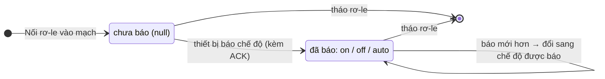

- Báo cáo chế độ đi kèm ACK của một lệnh. Nó chỉ được ghi khi `seq` của lệnh **lớn hơn** `mode_seq` hiện tại **và** chưa có
  lệnh nào mới hơn đã giao cho rơ-le đó (D-10) — ACK đến trễ của lệnh cũ không đè được chế độ mới.
- Tháo rơ-le xoá dòng `feeder_control`; nối lại là dòng mới, bắt đầu từ "chưa báo" (`mode_seq` mất theo). Lịch sử lệnh
  vẫn còn, nên ACK cũ chỉ bị chặn khi đã có lệnh **mới hơn được giao** cho rơ-le đó; nối lại mà chưa giao lệnh nào thì ACK
  cũ vẫn ghi được chế độ.

---

## 13. Phiên đăng nhập — refresh token

Mỗi lần đăng nhập mở một **chuỗi** token (`chain_id`); mỗi lần refresh **xoay** sang token mới trong cùng chuỗi. Trạng thái
suy từ `revoked_at`, `revoked_reason` và hai hạn: hạn trượt của token và hạn tuyệt đối của chuỗi.

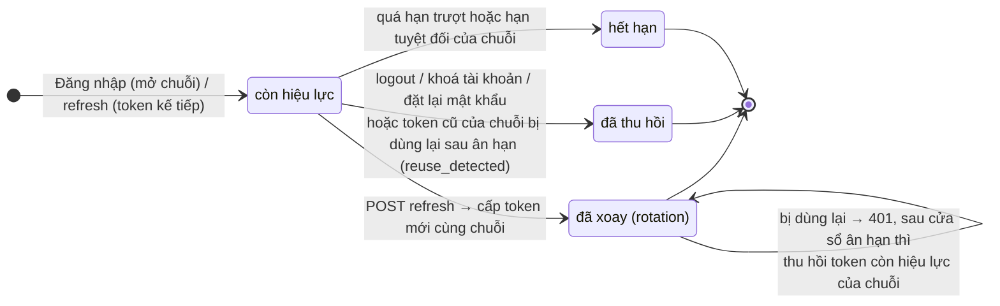

- `revoked_reason`: `rotation`, `logout`, `reuse_detected`, `account_locked`, `password_reset`. Token đã thu hồi hay hết
  hạn dùng lại → 401, **không** cấp gì.
- Token đã xoay bị dùng lại luôn nhận 401. Trong cửa sổ ân hạn (mặc định 30 giây, `ReuseGraceSeconds`) chỉ dừng ở đó:
  request thua trong một cặp refresh đồng thời không bị coi là đánh cắp. Sau cửa sổ đó, server coi là token bị lộ và thu
  hồi token còn hiệu lực của chuỗi — cả hai bên phải đăng nhập lại. Dùng lại token đã `logout` không bao giờ kích hoạt việc này.
- Khoá tài khoản thu hồi mọi refresh token (`account_locked`), nên refresh sau đó nhận **401**. Đăng nhập tài khoản đang
  khoá: sai mật khẩu → 401 như thường, **đúng** mật khẩu → 403 `ACCOUNT_LOCKED` (kiểm khoá sau mật khẩu để không lộ tài
  khoản có tồn tại).
- Không ghi `audit_event`: token không thuộc xã nào; phát hiện dùng lại được ghi log cảnh báo.
